# ERD de UPractice (versión 4)

Herramienta para exportar la imagen: https://mermaid.live/ (GitHub también renderiza el bloque de abajo).

**Cambios respecto a la versión 3** (decisiones D-22 y D-23 de `docs/fase-1/UPractice-Fase1.md`):

- Se conserva el nombre dividido en `Usuarios` (`Nombre1`, `Nombre2`, `Apellido1`, `Apellido2`).
- **Multi-tenant:** toda tabla transaccional principal lleva `EmpresaId` como **FK a `Empresas`** (lineamiento de la Fase 1). La PK es solo `Id`: `(Id, EmpresaId)` no puede ser PK porque `Id` ya es único (sería una superllave, no una llave candidata mínima). `(Id, EmpresaId)` queda como **clave alterna (UK)** en las tablas padre para que las hijas usen una **FK compuesta** y su `EmpresaId` nunca difiera del padre.
- `VacanteCarreras` y `VacanteHabilidades` no llevan `EmpresaId`: son tablas puente (atributos multivaluados de la vacante), no transacciones; heredan el aislamiento de su vacante.
- Se regresan las columnas que exigen las historias de usuario o las decisiones (por ejemplo `DebeCambiarPassword`, `IndiceMinimo`, `CumpleRequisitos`, `FechaCierre`) y se eliminan las que no son esenciales (`CreadoEn`/`UltimoAcceso` de usuarios, teléfono y resumen del perfil, carta de presentación, tamaños y nombres originales de archivo, fechas de auditoría duplicadas).

```mermaid
erDiagram
    Universidades ||--o{ Facultades : tiene
    Facultades ||--o{ Carreras : ofrece
    Universidades ||--o{ Usuarios : "estudiantes y coordinadores"
    Empresas ||--o{ Usuarios : "admins y reclutadores"
    Usuarios ||--o| PerfilesEstudiante : completa
    Carreras ||--o{ PerfilesEstudiante : cursa
    Usuarios ||--o{ EstudianteHabilidades : declara
    Habilidades ||--o{ EstudianteHabilidades : incluye
    Usuarios ||--o{ Curriculums : sube
    Empresas ||--o{ HabilitacionesEmpresa : solicita
    Universidades ||--o{ HabilitacionesEmpresa : resuelve

    Empresas ||--o{ Vacantes : publica
    Vacantes ||--|{ VacanteCarreras : "dirigida a"
    Carreras ||--o{ VacanteCarreras : incluye
    Vacantes ||--o{ VacanteHabilidades : pide
    Habilidades ||--o{ VacanteHabilidades : incluye

    Empresas ||--o{ Postulaciones : recibe
    Vacantes ||--o{ Postulaciones : recibe
    Usuarios ||--o{ Postulaciones : "se postula"
    Curriculums ||--o{ Postulaciones : adjunta
    Empresas ||--o{ HistorialPostulacion : registra
    Postulaciones ||--o{ HistorialPostulacion : registra
    Empresas ||--o{ Practicas : supervisa
    Postulaciones ||--o| Practicas : origina
    Empresas ||--o{ DocumentosPractica : custodia
    Practicas ||--o{ DocumentosPractica : expediente
    Empresas ||--o{ EvaluacionesEmpresa : recibe
    Practicas ||--o| EvaluacionesEmpresa : "estudiante evalua"
    Empresas ||--o{ EvaluacionesPracticante : emite
    Practicas ||--o| EvaluacionesPracticante : "empresa evalua"

    Universidades {
        uuid Id PK
        string Nombre
        string Siglas UK
        string DominioCorreo UK "dominio del correo estudiantil"
        bool Activa
    }
    Facultades {
        uuid Id PK
        uuid UniversidadId FK
        string Nombre
    }
    Carreras {
        uuid Id PK
        uuid FacultadId FK
        string Nombre
        bool Activa
    }
    Empresas {
        uuid Id PK "TENANT"
        string NombreComercial
        string RazonSocial
        string RTN UK "14 digitos"
        string Sector
        string SitioWeb "opcional"
        bool Activa "false = suspendida"
        string MotivoSuspension
        timestamptz CreadoEn "fecha de registro (HU-A04)"
    }
    HabilitacionesEmpresa {
        uuid Id PK
        uuid EmpresaId FK "TENANT"
        uuid UniversidadId FK
        string Estado "Pendiente, Aprobada, Rechazada"
        string MotivoRechazo
        uuid ResueltaPorId FK "Usuarios (Coordinador)"
        timestamptz FechaSolicitud
        timestamptz FechaResolucion
    }
    Usuarios {
        uuid Id PK
        string Correo UK
        string PasswordHash
        string Nombre1
        string Nombre2 "opcional"
        string Apellido1
        string Apellido2 "opcional"
        string Rol
        uuid EmpresaId FK "solo roles de empresa"
        uuid UniversidadId FK "solo Estudiante y Coordinador"
        bool Activo
        bool DebeCambiarPassword "D-17"
    }
    PerfilesEstudiante {
        uuid UsuarioId PK,FK
        string NumeroCuenta
        uuid CarreraId FK
        decimal IndiceAcademico "0 a 100"
        bool MostrarIndice "consentimiento"
        string EstadoVerificacion "Pendiente, Verificado, Rechazado"
        string ObservacionVerificacion
        uuid VerificadoPorId FK "Usuarios (Coordinador)"
        timestamptz FechaVerificacion
    }
    Habilidades {
        uuid Id PK
        string Nombre UK
    }
    EstudianteHabilidades {
        uuid EstudianteId PK,FK
        uuid HabilidadId PK,FK
    }
    Curriculums {
        uuid Id PK
        uuid EstudianteId FK
        string NombreVersion
        string ArchivoKey "ruta en el bucket"
        bool EsPrincipal
        bool Eliminado "baja logica"
    }
    Vacantes {
        uuid Id PK
        uuid EmpresaId FK "TENANT, UK(Id, EmpresaId)"
        uuid CreadaPorId FK "Usuarios"
        string Titulo
        text Descripcion
        string Modalidad "Presencial, Remota, Hibrida"
        string Ubicacion
        int Cupos
        bool Remunerada
        decimal IndiceMinimo "deseable, opcional"
        string Estado "Borrador, Publicada, Pausada, Cerrada"
        date FechaCierre
        timestamptz FechaPublicacion
    }
    VacanteCarreras {
        uuid VacanteId PK,FK
        uuid CarreraId PK,FK
    }
    VacanteHabilidades {
        uuid VacanteId PK,FK
        uuid HabilidadId PK,FK
        bool EsRequerida
    }
    Postulaciones {
        uuid Id PK
        uuid EmpresaId FK "TENANT, FK compuesta (VacanteId, EmpresaId)"
        uuid VacanteId FK
        uuid EstudianteId FK "Usuarios"
        uuid CurriculumId FK
        string Estado
        bool CumpleRequisitos "foto al postular (D-06)"
        timestamptz FechaPostulacion
    }
    HistorialPostulacion {
        uuid Id PK
        uuid EmpresaId FK "TENANT, FK compuesta (PostulacionId, EmpresaId)"
        uuid PostulacionId FK
        string EstadoAnterior
        string EstadoNuevo
        uuid CambiadoPorId FK "Usuarios"
        string Comentario
        timestamptz Fecha
    }
    Practicas {
        uuid Id PK "Sprint 2"
        uuid EmpresaId FK "TENANT, FK compuesta (PostulacionId, EmpresaId)"
        uuid PostulacionId FK,UK
        date FechaInicio
        date FechaFin
        int HorasCompletadas
        string Estado "EnCurso, Finalizada, Abandonada"
        bool FueContratado
    }
    DocumentosPractica {
        uuid Id PK "Sprint 2"
        uuid EmpresaId FK "TENANT, FK compuesta (PracticaId, EmpresaId)"
        uuid PracticaId FK
        string TipoDocumento
        string ArchivoKey "ruta en el bucket"
        uuid SubidoPorId FK "Usuarios"
        string EstadoRevision "Pendiente, Aprobado, Rechazado"
        uuid RevisadoPorId FK "Usuarios (Coordinador)"
        string ObservacionRevision
    }
    EvaluacionesEmpresa {
        uuid Id PK "Sprint 2"
        uuid EmpresaId FK "TENANT, FK compuesta (PracticaId, EmpresaId)"
        uuid PracticaId FK,UK
        smallint Calificacion "1 a 5"
        text Comentario
    }
    EvaluacionesPracticante {
        uuid Id PK "Sprint 2"
        uuid EmpresaId FK "TENANT, FK compuesta (PracticaId, EmpresaId)"
        uuid PracticaId FK,UK
        smallint Calificacion "1 a 5"
        text Comentario
    }
```

