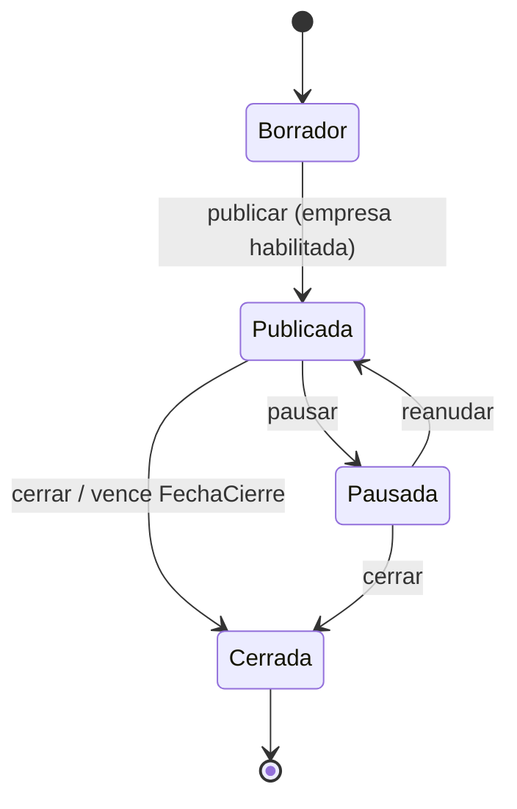

# UPractice — Fase 1: Ideación, Análisis y Gobierno Ágil

> Plataforma Web SaaS Multi-empresa · Proyecto final
> Entregable de la Fase 1 · Versión final · 7 de noviembre de 2026 · Actualizado 13 de noviembre de 2026 (D-22, D-23: ERD v4)

**Contenido**

1. [Pitch (1 página)](#1-pitch-1-página)
2. [Alcance, roles y decisiones de diseño](#2-alcance-roles-y-decisiones-de-diseño)
3. [Diseño multi-empresa y ERD en 3FN](#3-diseño-multi-empresa-multi-tenant-y-erd-en-3fn)
4. [Gobierno ágil: Kanban e Historias de Usuario](#4-gobierno-ágil-tablero-kanban-e-historias-de-usuario)
5. [Contratos de interfaz (API)](#5-contratos-de-interfaz-api)
6. [Apego a los lineamientos](#6-apego-a-los-lineamientos)

---

## 1. Pitch (1 página)

### UPractice — La práctica profesional, de la vacante a la evaluación, en un solo lugar

**El problema.** En Honduras, miles de estudiantes deben completar una práctica profesional para graduarse, pero conseguirla depende de contactos, redes sociales y publicaciones dispersas. Las coordinaciones académicas gestionan el proceso con correos, hojas de cálculo y papel, sin un registro uniforme de dónde practican sus estudiantes ni de cómo terminan. Las empresas, por su parte, reciben candidatos sin datos académicos verificables y no tienen un canal formal con las universidades.

**La solución.** UPractice es una plataforma SaaS B2B que conecta a empresas, estudiantes próximos a graduarse y coordinaciones académicas de varias universidades (UNAH, UNITEC, UTH, UNICAH…) y acompaña **todo el ciclo** de la práctica:

`Publicación → Postulación → Selección → Práctica en curso → Cierre → Evaluación`

**Para quién y qué gana cada uno**

| Actor | Valor |
|---|---|
| **Empresa** (cliente / tenant) | Publica vacantes dirigidas a carreras específicas, recibe postulantes con perfil académico **verificado por su universidad**, trabaja en equipo con varios reclutadores y construye reputación como empleador. |
| **Estudiante** | Encuentra en un solo lugar vacantes de empresas **aprobadas por su universidad**, sigue el estado de cada postulación y controla qué datos ve la empresa. |
| **Coordinación académica** | Aprueba qué empresas pueden reclutar a sus estudiantes, verifica perfiles, centraliza el expediente de cada práctica y obtiene indicadores de colocación. |

**Diferenciación.** Las bolsas de empleo generales o institucionales se limitan a publicar y postular. UPractice se especializa en la práctica profesional y su ciclo completo: empresas validadas por la universidad, perfiles verificados, expediente digital único y **evaluación bidireccional** (estudiante → empresa y empresa → practicante) que genera reputación basada en desempeño real, no solo en el índice académico.

**Modelo de negocio SaaS.**
- **Empresas (tenants):** plan Básico gratuito (1 reclutador, vacantes activas limitadas) y plan Pro por suscripción (reclutadores ilimitados, analítica de postulantes, perfil de marca empleadora).
- **Universidades:** licencia institucional anual por el panel de coordinación, el expediente digital y los indicadores.

**Impacto para Honduras.** Menos tiempo y menos intermediarios para conseguir práctica; transparencia sobre qué empresas cumplen con los practicantes; datos para que las universidades ajusten sus programas a las habilidades que demanda el mercado; y para las empresas hondureñas, una fuente confiable y de bajo costo de talento joven.

**MVP (Sprint 1).** Registro y roles · administración de la plataforma (universidades, carreras, coordinadores) · habilitación de empresas por universidad · verificación de perfiles · publicación y gestión de vacantes · postulación con CV · embudo de selección.

**Métricas de éxito.** % de estudiantes colocados · tiempo medio entre postulación y aceptación · tasa de finalización de prácticas · calificación promedio de empresas.

---

## 2. Alcance, roles y decisiones de diseño

### 2.1 Roles del sistema

| Rol | Pertenece a | Puede |
|---|---|---|
| `Estudiante` | Universidad | Completar perfil, subir CV, ver vacantes, postularse, responder ofertas. *(Sprint 2: expediente, evaluar empresa.)* |
| `Reclutador` | Empresa | Gestionar vacantes y postulantes de **su** empresa. |
| `AdminEmpresa` | Empresa | Todo lo del Reclutador + gestionar usuarios de la empresa y solicitudes de habilitación. |
| `Coordinador` | Universidad | Aprobar empresas para su universidad y verificar perfiles de sus estudiantes. *(Sprint 2: revisar expedientes, panel de indicadores.)* |
| `SuperAdmin` | Plataforma (operador de UPractice) | Administrar universidades, facultades, carreras, habilidades y cuentas de coordinador; suspender o reactivar empresas. **No ve datos de negocio de las empresas** (vacantes, postulaciones, perfiles de postulantes). |

### 2.2 ¿Cómo se crea cada cuenta?

Solo **una** cuenta nace del seed: el primer `SuperAdmin`. Todas las demás se crean desde la aplicación.

| Cuenta | Quién la crea | Cómo | Primer ingreso |
|---|---|---|---|
| `SuperAdmin` | **Seed**, al arrancar la API por primera vez | Correo y contraseña tomados de variables de entorno (`Seed__SuperAdminCorreo`, `Seed__SuperAdminPassword`). Si ya existe un SuperAdmin, el seed no hace nada. | Debe cambiar la contraseña (D-17). |
| `Coordinador` | El SuperAdmin, desde la pantalla de administración (HU-A03) | Elige la universidad e ingresa nombre y correo. El sistema genera una contraseña temporal que se muestra **una sola vez** y el SuperAdmin se la entrega al coordinador. | Debe cambiar la contraseña. |
| `AdminEmpresa` (primer usuario de la empresa) | **La propia empresa**, con el registro público (HU-E01) | Formulario "Registra tu empresa": datos de la empresa, datos del administrador y universidades a las que solicita habilitación. Empresa, usuario y solicitudes se crean en una sola transacción. | Entra directamente; no puede publicar hasta tener una habilitación aprobada. |
| `Reclutador` o `AdminEmpresa` adicional | El `AdminEmpresa` de esa empresa (HU-E02) | Pantalla "Usuarios de la empresa"; contraseña temporal igual que el coordinador. | Debe cambiar la contraseña. |
| `Estudiante` | **El propio estudiante**, con el registro público (HU-01) | Se registra con su correo institucional y la universidad se deduce del dominio. Luego completa su perfil y espera la verificación del coordinador. | Entra directamente. |

**Arranque de la plataforma** (una vez por ambiente):

1. Se despliega la API → el seed crea el SuperAdmin (y, en desarrollo, los datos de demostración).
2. El SuperAdmin registra cada universidad (nombre, siglas, dominio de correo), sus facultades y carreras, y crea al menos un coordinador por universidad.
3. Desde ahí la plataforma funciona sola: empresas y estudiantes se registran, y los coordinadores aprueban y verifican.

**Seed por ambiente**

| Ambiente | Qué carga el seed |
|---|---|
| Desarrollo y Docker local | SuperAdmin + datos de demostración: 2 universidades (UNAH, UNITEC) con facultades y carreras, catálogo de habilidades, 1 coordinador por universidad, 2 empresas aprobadas (necesarias para la prueba de aislamiento), estudiantes verificados y vacantes de ejemplo. Todas las cuentas de demo usan una contraseña conocida por el equipo. |
| Producción | Solo el SuperAdmin y el catálogo de habilidades. Universidades y carreras se crean desde la pantalla de administración (para la presentación pueden precargarse las universidades hondureñas con el mismo seed de demo, sin estudiantes ni empresas). |

### 2.3 Alcance por sprint

| Sprint | Contenido |
|---|---|
| **Sprint 0 – Base técnica** | Repositorio, solución Clean Architecture, BD + migraciones + seed por ambiente, JWT cifrado + aislamiento por tenant, middleware de errores, front base (router, Axios), Docker, despliegue "esqueleto". |
| **Sprint 1 – MVP** | HU-01 a HU-06, HU-E01 a HU-E07, HU-C01, HU-C02 y HU-A01 a HU-A04. |
| **Sprint 2 – Ciclo completo** | Práctica en curso y cierre, expediente de documentos, evaluaciones bidireccionales, reputación visible, panel de indicadores. |
| **Sprint 3 / futuro** | SSO institucional, clima laboral, recomendaciones, ferias, favoritos, mensajería, notificaciones por correo. |

### 2.4 Registro de decisiones

| # | Decisión | Motivo |
|---|---|---|
| D-01 | **El tenant es la Empresa.** Todas las tablas transaccionales de la empresa llevan `EmpresaId` y se filtran con `HasQueryFilter` usando el claim `empresa_id`. | Es lo que piden los lineamientos, y la empresa es el cliente que paga y cuyos datos (vacantes, postulantes, evaluaciones) deben estar aislados entre competidores. |
| D-02 | Estudiantes y coordinadores **no pertenecen a un tenant empresa**; su alcance se limita por `UsuarioId` y `UniversidadId` dentro del mismo filtro global. | UPractice es un mercado de dos lados: el estudiante debe ver vacantes de muchas empresas. El filtro global combina los tres alcances (§3.3) para que ninguna consulta quede sin restringir. |
| D-03 | **Autenticación propia con JWT** (correo + contraseña, hash con BCrypt o `PasswordHasher` de ASP.NET Core). El estudiante debe usar un correo cuyo dominio coincida con `Universidades.DominioCorreo`. El SSO queda en la visión futura. | No hay acceso al IdP de las universidades; los lineamientos exigen que el backend emita el JWT con el claim de empresa. |
| D-04 | **Datos académicos verificados por la coordinación**, no importados. El estudiante registra número de cuenta, carrera e índice académico; el coordinador los contrasta con el sistema de registro de su universidad y los marca como `Verificado`. Una vez verificados son **inmutables** para el estudiante. | Garantiza datos académicos confiables e inmutables sin depender de una integración con los sistemas de cada universidad. |
| D-05 | Empresas **habilitadas por universidad** (tabla `HabilitacionesEmpresa`), no con un único estado global. | Con varias universidades, cada coordinación decide qué empresas pueden reclutar a sus estudiantes (HU-04 y HU-E01). |
| D-06 | **Carrera = requisito excluyente** (bloquea la postulación). **Índice mínimo = requisito deseable**: no bloquea, pero la postulación guarda `CumpleRequisitos` y la empresa puede filtrar por él. | Permite que la empresa priorice sin excluir automáticamente, y evita que el índice sea el único criterio (en línea con la idea de "mérito sobre índice"). |
| D-07 | Una sola máquina de estados para Vacante, Postulación, Habilitación y Verificación (§3.6). | Backend, frontend e historias de usuario usan exactamente los mismos estados y transiciones. |
| D-08 | Identificadores `uuid` (Guid) en todas las tablas. | No son secuenciales ni adivinables entre tenants, y se pueden generar en el dominio antes de guardar. |
| D-09 | Archivos en **almacenamiento de objetos** (Supabase Storage con bucket privado en producción, carpeta local montada como volumen en Docker). La BD guarda solo `ArchivoKey`; las descargas usan **URL firmadas temporales**. Detalle en §3.8. | El disco de Render es efímero; además así ningún archivo es público. |
| D-10 | Estados y tipos fijos (rol, modalidad, estados) se guardan como **texto con `CHECK`** (`HasConversion<string>()`), no como tablas catálogo. Los datos que crecen (universidades, carreras, habilidades) **sí** son tablas. | Valores definidos por el código, legibles en la BD y validados por el motor. |
| D-11 | Evaluación de la empresa con **autor oculto, no anónimo**: el autor siempre queda registrado (vía la práctica) y la coordinación puede verlo; solo se oculta a la empresa. La reputación se muestra cuando la empresa tiene al menos 3 evaluaciones. | Evita evaluaciones falsas o abusivas sin exponer al estudiante ante la empresa. |
| D-12 | El puntaje por universidad y la reputación de la empresa **se calculan** (promedios en consulta), no se guardan. | Guardarlos violaría 3FN y podría desincronizarse. |
| D-13 | **Clima laboral fuera del MVP** (Sprint 3, opcional). | No tiene HU asociadas, sus usuarios (trabajadores de la empresa) no existen en el modelo, y compite en tiempo con el núcleo del producto. |
| D-14 | **Rol `SuperAdmin` con pantalla de administración** de la plataforma. El seed solo crea el primer SuperAdmin. | Permite incorporar universidades, carreras y coordinadores sin modificar código ni volver a desplegar. En un SaaS real el operador administra a sus clientes desde la aplicación. El SuperAdmin no tiene tenant y **no ve datos de negocio de las empresas** (privacidad de los tenants). |
| D-15 | **JWT firmado y cifrado (JWE)**: se firma con HS256 y se cifra con A256KW + A256CBC-HS512. | El lineamiento de la Fase 2 pide que el `EmpresaId` viaje **encriptado** en el token. Un JWT normal solo va firmado y su contenido se puede leer. |
| D-16 | **Sin créditos académicos** en el perfil ni en las vacantes. El requisito académico es la carrera y, de forma opcional, el índice. | En Honduras las unidades valorativas sirven para controlar la carga académica de cada período; no ayudan a elegir practicante. |
| D-17 | Las cuentas creadas por otra persona (SuperAdmin del seed, coordinadores, reclutadores) nacen con `DebeCambiarPassword = true`. Hasta cambiarla, la API solo permite `GET /auth/me` y `PUT /auth/password` (403 `CAMBIO_PASSWORD_REQUERIDO`). | Quien crea la cuenta conoce la contraseña temporal, y el MVP no envía correos. |
| D-18 | **Supabase** como proveedor en la nube para PostgreSQL **y** almacenamiento de archivos (mismo proyecto gratuito). API en Render, frontend en Vercel. | Los lineamientos permiten Neon o Supabase para la BD; Supabase además ofrece Storage gratis, así se evita sumar un tercer servicio. |
| D-19 | **Un usuario de empresa pertenece a una sola empresa** (`Usuarios.EmpresaId`, relación 1:N, sin tabla intermedia). Quien trabaje para dos empresas usa dos cuentas, cada una con su correo corporativo. | El token lleva un solo `empresa_id`, que es la base del aislamiento: con varias empresas por usuario habría que elegir empresa al iniciar sesión y emitir un token por empresa. En la práctica, un reclutador trabaja con el correo de su empresa, y `Correo` es único. Si en el futuro se atienden agencias de reclutamiento, se agrega una tabla `UsuarioEmpresas` sin cambiar el resto del modelo. |
| D-20 | **Una postulación por estudiante y vacante** (`UK(VacanteId, EstudianteId)`). Volver a postularse **solo es posible si el propio estudiante la retiró**: la misma fila vuelve a `Enviada` (se conserva su historial). Si fue `Rechazada`, `Declinada` o `Aceptada`, no se puede repetir en esa vacante, pero sí postularse a otras vacantes, incluso de la misma empresa. Un estudiante con una oferta `Aceptada` no puede postularse ni reactivar postulaciones. | Evita postulaciones repetidas que llenan el embudo de la empresa, respeta la decisión de la empresa y del estudiante, y deja trazabilidad completa en `HistorialPostulacion`. |
| D-21 | **Application referencia `Microsoft.EntityFrameworkCore`**: `IAppDbContext` (en Application) expone `DbSet<T>` y los *handlers* consultan con LINQ directamente, sin repositorios genéricos. Application sigue sin conocer Npgsql ni `AppDbContext`, que viven en Infrastructure. | Ya está así en `main` (T-01, PR #38). Evita una capa de repositorios que solo repetiría a EF, y los filtros globales siguen aplicándose porque la implementación es el `AppDbContext`. |
| D-22 | **PK simple `Id` y `EmpresaId` como FK en toda tabla transaccional** (`HabilitacionesEmpresa`, `Vacantes`, `Postulaciones`, `HistorialPostulacion`, `Practicas`, `DocumentosPractica`, `Evaluaciones*`). Las tablas padre tienen la **clave alterna `(Id, EmpresaId)`** y las hijas la referencian con una **FK compuesta**. Las tablas puente `VacanteCarreras` y `VacanteHabilidades` no llevan `EmpresaId` y heredan el aislamiento de la vacante. | Cumple el lineamiento ("todas las tablas transaccionales principales deben incluir `EmpresaId` como llave foránea") sin usar `(Id, EmpresaId)` como PK: como `Id` ya es único, esa PK sería una superllave y no una llave candidata mínima, y obligaría a cargar `EmpresaId` en cada ruta y en cada FK (incluso para estudiantes, que no tienen empresa). El filtro global usa `EmpresaId` directo, sin *joins*. |
| D-23 | **Modelo mínimo (ERD v4).** `Usuarios` guarda el nombre dividido (`Nombre1`, `Nombre2`, `Apellido1`, `Apellido2`); la API sigue devolviendo `nombreCompleto` calculado. Se eliminan columnas que ninguna HU ni lineamiento exige: `Usuarios.CreadoEn/UltimoAcceso`, `Universidades.CreadoEn`, `Empresas.Descripcion`, `PerfilesEstudiante.Telefono/Resumen/MostrarTelefono`, `Curriculums.NombreOriginal/TamanoBytes/SubidoEn`, `Vacantes.CreadoEn`, `Postulaciones.CartaPresentacion/FechaUltimoCambio` (se obtiene del historial) y columnas de auditoría del Sprint 2. | Menos columnas que mantener, validar y migrar en el tiempo disponible, y mejor 3FN (`FechaUltimoCambio` era derivable). Se conservan las columnas que sostienen reglas: `DebeCambiarPassword` (D-17), `IndiceMinimo` y `CumpleRequisitos` (D-06), `MostrarIndice` (privacidad), `Eliminado` (HU-03), `FechaCierre`, `FechaPublicacion`, y quién y cuándo resolvió habilitaciones y verificaciones. |

---

## 3. Diseño multi-empresa (multi-tenant) y ERD en 3FN

### 3.1 Concepto de tenant

- **Tenant = `Empresa`.** Cada empresa ve **solo** sus vacantes, postulantes, prácticas, documentos y evaluaciones.
- El `EmpresaId` del usuario **nunca viene del body ni de la URL**: se lee del claim `empresa_id` del JWT, lo expone un servicio `ICurrentUser` (Application) y lo consume el `DbContext` (Infrastructure).
- Si un usuario de la empresa A pide por id un recurso de la empresa B, el filtro global hace que no exista: la API responde **404** (no 403, para no revelar que existe).

### 3.2 Matriz de visibilidad (qué fila ve cada rol)

| Tabla | AdminEmpresa / Reclutador | Estudiante | Coordinador |
|---|---|---|---|
| `Vacantes` | `EmpresaId = claim` | `Estado = Publicada` y empresa con habilitación `Aprobada` en su universidad | Vacantes de empresas que solicitaron habilitación en su universidad |
| `Postulaciones` | `EmpresaId = claim` | `EstudianteId = sub` | Estudiante de su universidad |
| `PerfilesEstudiante` | Solo estudiantes que se postularon a su empresa (respetando privacidad) | El propio | Estudiantes de su universidad |
| `Curriculums` | Solo el CV adjunto a una postulación a su empresa | Los propios | — |
| `HabilitacionesEmpresa` | `EmpresaId = claim` | — | `UniversidadId = claim` |
| `Practicas`, `DocumentosPractica`, `Evaluaciones*` *(Sprint 2)* | `EmpresaId = claim` | Las de sus postulaciones | Las de sus estudiantes |

**SuperAdmin:** solo lee `HabilitacionesEmpresa` (todas, para supervisar empresas) y las tablas sin filtro (`Universidades`, `Facultades`, `Carreras`, `Habilidades`, `Empresas`, `Usuarios`). En el resto de tablas no tiene ninguna condición en el filtro global, así que no ve filas.

**Empresa suspendida** (`Empresas.Activa = false`): sus usuarios no pueden iniciar sesión y sus vacantes desaparecen para los estudiantes.

### 3.3 Guía de implementación del filtro global (para la Fase 2)

```csharp
// Application/Abstractions
public interface ICurrentUser
{
    Guid? UsuarioId { get; }
    Rol? Rol { get; }
    Guid? EmpresaId { get; }      // claim "empresa_id"
    Guid? UniversidadId { get; }  // claim "universidad_id"
}

// Infrastructure/Persistence/AppDbContext.cs
public sealed class AppDbContext(DbContextOptions<AppDbContext> options, ICurrentUser usuario)
    : DbContext(options)
{
    // Propiedades del propio DbContext: EF las convierte en parámetros por cada petición.
    private Guid? EmpresaActualId => usuario.EmpresaId;
    private Guid? UniversidadActualId => usuario.UniversidadId;
    private Guid? UsuarioActualId => usuario.UsuarioId;
    private Rol? RolActual => usuario.Rol;

    protected override void OnModelCreating(ModelBuilder b)
    {
        b.ApplyConfigurationsFromAssembly(typeof(AppDbContext).Assembly);

        b.Entity<Vacante>().HasQueryFilter(v =>
               (EmpresaActualId != null && v.EmpresaId == EmpresaActualId)
            || (RolActual == Rol.Estudiante
                && v.Estado == EstadoVacante.Publicada
                && v.Empresa.Activa
                && v.Empresa.Habilitaciones.Any(h => h.UniversidadId == UniversidadActualId
                                                  && h.Estado == EstadoHabilitacion.Aprobada))
            || (RolActual == Rol.Coordinador
                && v.Empresa.Habilitaciones.Any(h => h.UniversidadId == UniversidadActualId)));

        b.Entity<Postulacion>().HasQueryFilter(p =>
               (EmpresaActualId != null && p.EmpresaId == EmpresaActualId)
            || (RolActual == Rol.Estudiante && p.EstudianteId == UsuarioActualId)
            || (RolActual == Rol.Coordinador && p.Estudiante.UniversidadId == UniversidadActualId));

        // Mismo patrón para HabilitacionesEmpresa, Curriculums, PerfilesEstudiante,
        // Practicas, DocumentosPractica y Evaluaciones (ver matriz §3.2).
    }
}
```

Reglas para el equipo:
- Las tablas transaccionales hijas (`HistorialPostulacion`, `DocumentosPractica`, `Evaluaciones*`) llevan `EmpresaId` y se filtran igual que su padre (D-22). Las tablas puente sin `EmpresaId` (`VacanteCarreras`, `VacanteHabilidades`) reciben un filtro equivalente **a través de su navegación a la vacante**, para que EF no emita la advertencia de "navegación requerida con filtro" (10622) y no aparezcan filas huérfanas.
- `Usuarios`, `Empresas` y los catálogos **no** llevan filtro global (el login necesita buscar por correo sin usuario autenticado); sus consultas se limitan en Application.
- El `SuperAdmin` solo aparece en el filtro de `HabilitacionesEmpresa` (`|| RolActual == Rol.SuperAdmin`); en las demás tablas filtradas no ve filas.
- `IgnoreQueryFilters()` solo se permite en login, seed y jobs internos, y **debe revisarse en el PR**.
- **Prueba obligatoria de aislamiento** (Sprint 0): con dos empresas en la BD de prueba, un reclutador de A no puede listar, leer, editar ni postular sobre datos de B.

### 3.4 Diagrama Entidad-Relación

> Versión 4 del diagrama (D-22, D-23). La fuente editable es `docs/diagrama-mermaid.md`; GitHub renderiza el bloque y la imagen se exporta desde [mermaid.live](https://mermaid.live). Las tablas marcadas *Sprint 2* se crean en ese sprint, pero el diseño ya está cerrado.

```mermaid
erDiagram
    Universidades ||--o{ Facultades : tiene
    Facultades ||--o{ Carreras : ofrece
    Universidades ||--o{ Usuarios : "estudiantes y coordinadores"
    Empresas ||--o{ Usuarios : "admins y reclutadores"
    Usuarios ||--o| PerfilesEstudiante : completa
    Carreras ||--o{ PerfilesEstudiante : cursa
    Usuarios ||--o{ EstudianteHabilidades : declara
    Habilidades ||--o{ EstudianteHabilidades : incluye
    Usuarios ||--o{ Curriculums : sube
    Empresas ||--o{ HabilitacionesEmpresa : solicita
    Universidades ||--o{ HabilitacionesEmpresa : resuelve

    Empresas ||--o{ Vacantes : publica
    Vacantes ||--|{ VacanteCarreras : "dirigida a"
    Carreras ||--o{ VacanteCarreras : incluye
    Vacantes ||--o{ VacanteHabilidades : pide
    Habilidades ||--o{ VacanteHabilidades : incluye

    Empresas ||--o{ Postulaciones : recibe
    Vacantes ||--o{ Postulaciones : recibe
    Usuarios ||--o{ Postulaciones : "se postula"
    Curriculums ||--o{ Postulaciones : adjunta
    Empresas ||--o{ HistorialPostulacion : registra
    Postulaciones ||--o{ HistorialPostulacion : registra
    Empresas ||--o{ Practicas : supervisa
    Postulaciones ||--o| Practicas : origina
    Empresas ||--o{ DocumentosPractica : custodia
    Practicas ||--o{ DocumentosPractica : expediente
    Empresas ||--o{ EvaluacionesEmpresa : recibe
    Practicas ||--o| EvaluacionesEmpresa : "estudiante evalua"
    Empresas ||--o{ EvaluacionesPracticante : emite
    Practicas ||--o| EvaluacionesPracticante : "empresa evalua"

    Universidades {
        uuid Id PK
        string Nombre
        string Siglas UK
        string DominioCorreo UK "dominio del correo estudiantil"
        bool Activa
    }
    Facultades {
        uuid Id PK
        uuid UniversidadId FK
        string Nombre
    }
    Carreras {
        uuid Id PK
        uuid FacultadId FK
        string Nombre
        bool Activa
    }
    Empresas {
        uuid Id PK "TENANT"
        string NombreComercial
        string RazonSocial
        string RTN UK "14 digitos"
        string Sector
        string SitioWeb "opcional"
        bool Activa "false = suspendida"
        string MotivoSuspension
        timestamptz CreadoEn "fecha de registro (HU-A04)"
    }
    HabilitacionesEmpresa {
        uuid Id PK
        uuid EmpresaId FK "TENANT"
        uuid UniversidadId FK
        string Estado "Pendiente, Aprobada, Rechazada"
        string MotivoRechazo
        uuid ResueltaPorId FK "Usuarios (Coordinador)"
        timestamptz FechaSolicitud
        timestamptz FechaResolucion
    }
    Usuarios {
        uuid Id PK
        string Correo UK
        string PasswordHash
        string Nombre1
        string Nombre2 "opcional"
        string Apellido1
        string Apellido2 "opcional"
        string Rol
        uuid EmpresaId FK "solo roles de empresa"
        uuid UniversidadId FK "solo Estudiante y Coordinador"
        bool Activo
        bool DebeCambiarPassword "D-17"
    }
    PerfilesEstudiante {
        uuid UsuarioId PK,FK
        string NumeroCuenta
        uuid CarreraId FK
        decimal IndiceAcademico "0 a 100"
        bool MostrarIndice "consentimiento"
        string EstadoVerificacion "Pendiente, Verificado, Rechazado"
        string ObservacionVerificacion
        uuid VerificadoPorId FK "Usuarios (Coordinador)"
        timestamptz FechaVerificacion
    }
    Habilidades {
        uuid Id PK
        string Nombre UK
    }
    EstudianteHabilidades {
        uuid EstudianteId PK,FK
        uuid HabilidadId PK,FK
    }
    Curriculums {
        uuid Id PK
        uuid EstudianteId FK
        string NombreVersion
        string ArchivoKey "ruta en el bucket"
        bool EsPrincipal
        bool Eliminado "baja logica"
    }
    Vacantes {
        uuid Id PK
        uuid EmpresaId FK "TENANT, UK(Id, EmpresaId)"
        uuid CreadaPorId FK "Usuarios"
        string Titulo
        text Descripcion
        string Modalidad "Presencial, Remota, Hibrida"
        string Ubicacion
        int Cupos
        bool Remunerada
        decimal IndiceMinimo "deseable, opcional"
        string Estado "Borrador, Publicada, Pausada, Cerrada"
        date FechaCierre
        timestamptz FechaPublicacion
    }
    VacanteCarreras {
        uuid VacanteId PK,FK
        uuid CarreraId PK,FK
    }
    VacanteHabilidades {
        uuid VacanteId PK,FK
        uuid HabilidadId PK,FK
        bool EsRequerida
    }
    Postulaciones {
        uuid Id PK
        uuid EmpresaId FK "TENANT, FK compuesta (VacanteId, EmpresaId)"
        uuid VacanteId FK
        uuid EstudianteId FK "Usuarios"
        uuid CurriculumId FK
        string Estado
        bool CumpleRequisitos "foto al postular (D-06)"
        timestamptz FechaPostulacion
    }
    HistorialPostulacion {
        uuid Id PK
        uuid EmpresaId FK "TENANT, FK compuesta (PostulacionId, EmpresaId)"
        uuid PostulacionId FK
        string EstadoAnterior
        string EstadoNuevo
        uuid CambiadoPorId FK "Usuarios"
        string Comentario
        timestamptz Fecha
    }
    Practicas {
        uuid Id PK "Sprint 2"
        uuid EmpresaId FK "TENANT, FK compuesta (PostulacionId, EmpresaId)"
        uuid PostulacionId FK,UK
        date FechaInicio
        date FechaFin
        int HorasCompletadas
        string Estado "EnCurso, Finalizada, Abandonada"
        bool FueContratado
    }
    DocumentosPractica {
        uuid Id PK "Sprint 2"
        uuid EmpresaId FK "TENANT, FK compuesta (PracticaId, EmpresaId)"
        uuid PracticaId FK
        string TipoDocumento
        string ArchivoKey "ruta en el bucket"
        uuid SubidoPorId FK "Usuarios"
        string EstadoRevision "Pendiente, Aprobado, Rechazado"
        uuid RevisadoPorId FK "Usuarios (Coordinador)"
        string ObservacionRevision
    }
    EvaluacionesEmpresa {
        uuid Id PK "Sprint 2"
        uuid EmpresaId FK "TENANT, FK compuesta (PracticaId, EmpresaId)"
        uuid PracticaId FK,UK
        smallint Calificacion "1 a 5"
        text Comentario
    }
    EvaluacionesPracticante {
        uuid Id PK "Sprint 2"
        uuid EmpresaId FK "TENANT, FK compuesta (PracticaId, EmpresaId)"
        uuid PracticaId FK,UK
        smallint Calificacion "1 a 5"
        text Comentario
    }
```



### 3.5 Restricciones e índices

| Tabla | Restricciones (además de PK/FK) |
|---|---|
| `Universidades` | `UK(Siglas)`, `UK(DominioCorreo)`. |
| `Facultades` | `UK(UniversidadId, Nombre)`. |
| `Carreras` | `UK(FacultadId, Nombre)`. |
| `Habilidades` | `UK(Nombre)` sin distinguir mayúsculas (índice sobre `lower(Nombre)`). |
| `Empresas` | `UK(RTN)`, `CHECK (RTN ~ '^[0-9]{14}$')`; `CHECK (Activa OR MotivoSuspension IS NOT NULL)`. |
| `HabilitacionesEmpresa` | `UK(EmpresaId, UniversidadId)`; `CHECK Estado`; `CHECK (Estado <> 'Rechazada' OR MotivoRechazo IS NOT NULL)`. |
| `Usuarios` | `UK(Correo)` (guardado en minúsculas); `Nombre1` y `Apellido1` obligatorios; `CHECK`: roles `Reclutador`/`AdminEmpresa` ⇒ `EmpresaId NOT NULL AND UniversidadId IS NULL` (un usuario de empresa pertenece a una sola empresa, D-19); roles `Estudiante`/`Coordinador` ⇒ `UniversidadId NOT NULL AND EmpresaId IS NULL`; rol `SuperAdmin` ⇒ ambos `NULL`. |
| `PerfilesEstudiante` | PK compartida con `Usuarios` (relación 1:1); `CHECK IndiceAcademico BETWEEN 0 AND 100`; `CHECK (EstadoVerificacion <> 'Rechazado' OR ObservacionVerificacion IS NOT NULL)`. `NumeroCuenta` único por universidad (se valida en Application, porque `UniversidadId` vive en `Usuarios`). |
| `Curriculums` | Índice único parcial: un solo `EsPrincipal` por estudiante `WHERE EsPrincipal AND NOT Eliminado` (`HasFilter` en EF). |
| `Vacantes` | **Clave alterna `(Id, EmpresaId)`**; `CHECK Cupos BETWEEN 1 AND 50`; `CHECK IndiceMinimo BETWEEN 0 AND 100`; índices `(EmpresaId, Estado)` y `(Estado, FechaCierre)`. |
| `Postulaciones` | `UK(VacanteId, EstudianteId)`; **FK compuesta `(VacanteId, EmpresaId) → Vacantes(Id, EmpresaId)`**; clave alterna `(Id, EmpresaId)`; índices `(EmpresaId, Estado)` y `(EstudianteId)`. |
| `HistorialPostulacion` | FK compuesta `(PostulacionId, EmpresaId) → Postulaciones(Id, EmpresaId)`; índice `(PostulacionId, Fecha)`. |
| `Practicas` | `UK(PostulacionId)`; FK compuesta `(PostulacionId, EmpresaId) → Postulaciones(Id, EmpresaId)`; clave alterna `(Id, EmpresaId)`. |
| `DocumentosPractica`, `EvaluacionesEmpresa`, `EvaluacionesPracticante` | FK compuesta `(PracticaId, EmpresaId) → Practicas(Id, EmpresaId)`; evaluaciones con `UK(PracticaId)` y `CHECK Calificacion BETWEEN 1 AND 5`. |

### 3.6 Máquinas de estado

**Vacante**



- Solo se edita en `Borrador` o `Pausada`. `Cerrada` es definitivo.
- Una vacante `Publicada` cuya `FechaCierre` ya pasó se trata como `Cerrada` (en la consulta y con un job opcional que actualiza el estado).

**Postulación**

| Desde | Hacia | Quién | Condición |
|---|---|---|---|
| — | `Enviada` | Estudiante | Perfil `Verificado`, carrera elegible, vacante `Publicada` y vigente, sin postulación previa. |
| `Enviada` | `EnRevision` | Empresa | — |
| `Enviada`, `EnRevision` | `Entrevista` | Empresa | — |
| `EnRevision`, `Entrevista` | `Oferta` | Empresa | Quedan cupos (ofertas aceptadas < `Cupos`). |
| `Enviada`, `EnRevision`, `Entrevista` | `Rechazada` | Empresa | — |
| `Oferta` | `Aceptada` | Estudiante | Sus demás postulaciones activas pasan a `Retirada`. *(Sprint 2: crea la `Practica`.)* |
| `Oferta` | `Declinada` | Estudiante | — |
| `Enviada`, `EnRevision`, `Entrevista` | `Retirada` | Estudiante | — |
| `Retirada` | `Enviada` | Estudiante | **Reactivar** (D-20): vacante `Publicada` y vigente, perfil `Verificado`, carrera elegible y sin ninguna postulación `Aceptada`. Puede elegir otro CV; `CumpleRequisitos` se recalcula. |

Estados finales: `Aceptada`, `Declinada`, `Rechazada`. `Retirada` también es final, salvo que el estudiante la reactive. Cada transición inserta una fila en `HistorialPostulacion`; cualquier otra transición responde **422 `TRANSICION_INVALIDA`**.

**Habilitación de empresa:** `Pendiente → Aprobada | Rechazada`; desde `Rechazada` la empresa puede volver a solicitar (`→ Pendiente`).
**Verificación de perfil:** `Pendiente → Verificado | Rechazado`; si fue `Rechazado`, el estudiante corrige y vuelve a `Pendiente`.
**Práctica (Sprint 2):** `EnCurso → Finalizada | Abandonada`; `FueContratado` se registra al cierre.

### 3.7 Justificación de la Tercera Forma Normal

- **1FN.** Todos los atributos son atómicos. Las listas (carreras de una vacante, habilidades) se modelan como tablas intermedias (`VacanteCarreras`, `VacanteHabilidades`, `EstudianteHabilidades`) en lugar de columnas con varios valores.
- **2FN.** Las tablas con PK compuesta (`VacanteCarreras`, `VacanteHabilidades`, `EstudianteHabilidades`) solo tienen atributos que dependen de la clave completa (`EsRequerida` depende de la vacante *y* de la habilidad).
- **3FN.** No hay dependencias transitivas:
  - El perfil guarda solo `CarreraId`; la facultad y la universidad se obtienen por `Carreras → Facultades → Universidades`.
  - Las evaluaciones no repiten `EstudianteId`; se obtiene por `Practica → Postulacion`.
  - La reputación de la empresa y el puntaje por universidad se calculan, no se guardan (D-12).
- **Llaves.** Todas las tablas con identidad propia usan PK simple `Id` (uuid). `(Id, EmpresaId)` no es PK porque no es mínima (`Id` ya identifica la fila); se declara como clave alterna solo para que las FK compuestas la referencien (D-22).
- **`FechaUltimoCambio` no se guarda**: es la fecha del último registro de `HistorialPostulacion` (se calcula en la consulta).
- **Desnormalización controlada de `EmpresaId`.** En `Postulaciones`, `HistorialPostulacion`, `Practicas`, `DocumentosPractica` y `Evaluaciones*`, `EmpresaId` técnicamente se puede deducir del padre. Se incluye porque los lineamientos exigen `EmpresaId` en todas las tablas transaccionales principales para el filtro global. **No genera anomalías**: la FK compuesta `(PadreId, EmpresaId) → Padre(Id, EmpresaId)` obliga a que siempre coincida con la del padre, y el `EmpresaId` de un registro nunca cambia.
- **`CumpleRequisitos`** no es un dato derivable: es una foto del cumplimiento en el momento de postular (el índice del estudiante puede cambiar después).

### 3.8 Almacenamiento de archivos (`ArchivoKey`)

**Qué es.** `ArchivoKey` es la **ruta del archivo dentro del almacenamiento**: no es el archivo ni una URL. Los PDF nunca se guardan en PostgreSQL ni en el disco del servidor de la API. Funciona igual en `Curriculums` y en `DocumentosPractica`.

**Dónde se guarda**

| Ambiente | Lugar | Configuración |
|---|---|---|
| Producción | **Supabase Storage**, bucket **privado** `upractice-archivos`, en el mismo proyecto de Supabase que la base de datos (D-18). | La API se conecta con la *service role key* de Supabase, que vive solo en las variables de entorno de Render. **Nunca** va en el frontend ni en el repositorio. |
| Desarrollo y Docker | Carpeta `/app/storage` dentro del contenedor de la API, montada como volumen `upractice-storage` en `docker-compose.yml`. | `Storage__Proveedor=Local`. |

Por qué no en otro lugar:
- **En la base de datos** (`bytea`): llenaría rápido el espacio gratuito de PostgreSQL y haría pesados los respaldos.
- **En el disco de Render**: es efímero, se borra en cada despliegue.
- **En un bucket público**: cualquiera con el enlace vería el CV.

**Formato de la llave** (la genera la API, nunca el usuario)

| Tabla | `ArchivoKey` | Ejemplo |
|---|---|---|
| `Curriculums` | `curriculums/{estudianteId}/{curriculumId}.pdf` | `curriculums/3f2a…/9c1d….pdf` |
| `DocumentosPractica` | `practicas/{empresaId}/{practicaId}/{documentoId}.pdf` | `practicas/7b10…/a44e…/c0d9….pdf` |

Se usan ids, y no el nombre original, para evitar nombres repetidos o con caracteres raros y para que nadie adivine rutas. El nombre de descarga se arma con datos que ya existen (`{NombreVersion}.pdf` para el CV, `{TipoDocumento}.pdf` para el expediente), así que no se guarda el nombre original (D-23).

**Subida** (ej. `POST /estudiantes/me/curriculums`)
1. El frontend envía `multipart/form-data` a **la API**, nunca directo a Supabase.
2. La API valida que sea PDF (extensión, tipo MIME y que el archivo empiece con `%PDF`), que pese ≤ 5 MB y el límite de versiones.
3. Genera el `Id` del registro y la llave, y sube el archivo con `IAlmacenamientoArchivos.SubirAsync(...)`.
4. Guarda la fila con su `ArchivoKey`. Si guardar en la BD falla, borra el objeto recién subido para no dejar archivos huérfanos.

**Descarga** (ej. `GET /empresa/postulaciones/{id}/curriculum/descarga`)
1. La API busca el registro **a través del filtro global**: si el usuario no tiene permiso, la fila "no existe" y responde 404.
2. Pide al storage una **URL firmada** para esa llave, válida 5 minutos, y la devuelve (`UrlDescargaDto`).
3. El frontend abre esa URL. Cuando vence, el enlace deja de funcionar aunque alguien lo haya copiado.

En local, la implementación `Local` genera una URL hacia la propia API (`GET /api/v1/archivos/local?key=…&exp=…&sig=…`) firmada con HMAC, para que el frontend funcione igual en los dos ambientes.

**Abstracción** (interfaz en Application; implementaciones `SupabaseStorage` y `LocalStorage` en Infrastructure, elegidas por configuración):

```csharp
public interface IAlmacenamientoArchivos
{
    Task SubirAsync(string key, Stream contenido, string contentType, CancellationToken ct);
    Task<UrlDescarga> ObtenerUrlDescargaAsync(string key, TimeSpan vigencia, string nombreDescarga, CancellationToken ct);
    Task EliminarAsync(string key, CancellationToken ct);
}
```

Como la BD guarda la llave y no la URL completa, cambiar de proveedor de almacenamiento no requiere migrar datos.

**Eliminación.** Borrar un CV es una baja lógica (`Eliminado = true`) y el objeto se conserva, porque puede estar adjunto a postulaciones. Los documentos de práctica aprobados no se eliminan, porque forman parte del expediente oficial.

> Para la Fase 5: el plan gratuito de Supabase tiene límites de espacio para la BD y para archivos, y pausa los proyectos que pasan un tiempo sin actividad. Antes de la presentación, revisar en el panel de Supabase que el proyecto esté activo.

---

## 4. Gobierno ágil: tablero Kanban e Historias de Usuario

### 4.1 Configuración del tablero (GitHub Projects)

**Lista de verificación del tablero**

- [ ] Las HU son **issues reales** del repositorio, no *draft items* (los drafts no se pueden vincular a PR ni cerrar con `Closes #n`).
- [ ] Tablero: **Sistemas Expertos UPractice** (`https://github.com/users/DeibiXD/projects/3`).
- [ ] Columnas (campo *Status*): `Product Backlog` · `Ready` · `In progress` · `QA` (revisión del PR) · `Finalizado`.
- [ ] Campos: **Sprint** (selección única: `Sprint 0`, `Sprint 1`, `Cierre`, `Sprint 2`, `Futuro`), **Priority** (`Must`, `Should`, `Could`, `Won't`), **Estimate** (puntos: 1, 2, 3, 5, 8), **Área** (`Backend`, `Frontend`, `Full-stack`, `DevOps`, `Docs`), **Start date** y **Target date** (para la vista Roadmap).
- [ ] Cada HU tiene responsable, sprint, prioridad y estimación.
- [ ] Las tareas técnicas de una HU son **sub-issues** de ella.
- [ ] Vistas: *Backlog* (board por Status), *Priority board*, *Team items* (por responsable), *Roadmap*, *My items* y *Por sprint* (tabla agrupada por Sprint).
- [ ] Etiquetas: `historia`, `tarea`, `bug`, `backend`, `frontend`, `devops`, `docs`.
- [ ] Plantilla de issue en `.github/ISSUE_TEMPLATE/historia-usuario.md` (§4.8).

### 4.2 Definition of Ready (para pasar a `Ready`)

- Formato *Como / Quiero / Para* y criterios de aceptación verificables.
- Endpoints y DTO definidos en §5 (o actualizados en este documento).
- Estimada, priorizada y sin dependencias bloqueantes abiertas.

### 4.3 Definition of Done (para pasar a `Finalizado`)

- Cumple todos los criterios de aceptación.
- Backend: validador FluentValidation, filtro de tenant comprobado, prueba de aislamiento si toca datos de empresa.
- Frontend: esquema Zod simétrico al validador, errores del backend mostrados en el campo correcto.
- PR revisado y aprobado por al menos 1 compañero, CI en verde, mergeado a `main` y desplegado.
- Swagger refleja el contrato.

### 4.4 Acuerdos de trabajo en equipo

| Tema | Acuerdo |
|---|---|
| Repositorio | Monorepo: `backend/`, `frontend/`, `docs/`, `docker-compose.yml` en la raíz. |
| Ramas | `main` protegida (solo PR, 1 aprobación, CI verde). Ramas `feat/HU-05-postulacion`, `fix/…`, `chore/…`. |
| Commits | Conventional Commits: `feat(postulaciones): validar carrera elegible`. |
| PR | Título con el id de la HU y `Closes #<issue>` en la descripción. |
| Reparto | **Por vertical slice**, no por capa: quien toma "Vacantes" la hace de punta a punta (endpoint, validador, pantalla), para no bloquearse entre back y front. |
| Contratos | Cambiar un DTO o endpoint implica actualizar §5 **en el mismo PR** y avisar al equipo. |
| Migraciones EF | Antes de crear una migración: `git pull` de `main`. Nunca editar una migración que ya está en `main`. Si dos PR traen migraciones, el segundo la regenera tras el rebase. |
| Secretos | Nunca en el repo: `appsettings.Development.json` sin secretos, `.env.example` versionado, valores reales en Render/Vercel. |

Estructura sugerida:

```
upractice/
├─ backend/
│  ├─ src/
│  │  ├─ UPractice.Domain/          # Entidades, enums, reglas de transición
│  │  ├─ UPractice.Application/     # Features/<Modulo>/(Commands|Queries), validadores, DTO, ICurrentUser
│  │  ├─ UPractice.Infrastructure/  # EF Core, configuraciones, migraciones, JWT, storage
│  │  └─ UPractice.Api/             # Controllers/endpoints, middleware de errores, Program.cs
│  ├─ tests/
│  └─ Dockerfile
├─ frontend/
│  └─ src/
│     ├─ features/ auth · perfil · curriculums · vacantes · postulaciones · empresa · coordinacion
│     └─ shared/   api (axios + interceptores) · lib (extractor de errores) · components · routes
├─ docs/fase-1/                     # este documento
└─ docker-compose.yml
```

### 4.5 Historias técnicas (Sprint 0)

| Id | Historia técnica | Estim. |
|---|---|---|
| T-01 | Crear monorepo y solución .NET con las 4 capas y referencias correctas (Domain ← Application ← Infrastructure ← Api). | 2 |
| T-02 | `AppDbContext`, configuraciones Fluent API, migración inicial y seed por ambiente (§2.2): SuperAdmin inicial siempre; datos de demostración solo en desarrollo. | 5 |
| T-03 | Emisión y validación de JWT firmado y cifrado (JWE, D-15), política de cambio de contraseña obligatorio (D-17), `ICurrentUser`, filtros globales por tenant y **prueba de aislamiento entre dos empresas**. | 5 |
| T-04 | Middleware global de errores (ProblemDetails) + pipeline de FluentValidation, con llaves de error en camelCase. | 3 |
| T-05 | Frontend base: Vite + React + TS, rutas protegidas con `react-router-dom`, Axios con interceptor Bearer y manejo de 401, extractor universal de errores. | 5 |
| T-06 | Dockerfile multi-stage (SDK → runtime Alpine) y `docker-compose.yml` con PostgreSQL. | 3 |
| T-07 | Despliegue "esqueleto" (Supabase + Render + Vercel) con endpoint `/health` y despliegue automático desde `main`. | 3 |
| T-08 | Abstracción `IAlmacenamientoArchivos` con implementación local (dev) y Supabase Storage (prod), con URL firmadas (§3.8). | 3 |

> Desplegar el esqueleto **en el Sprint 0** reduce el riesgo de la Fase 5: los problemas de CORS, variables de entorno y cadenas de conexión aparecen pronto y no al final.

### 4.6 Historias de Usuario del Sprint 1

Formato de criterios: *Dado / Cuando / Entonces*. Los códigos de error referencian §5.4.

---

#### Estudiante

**HU-01 · Registro e inicio de sesión con correo institucional**
**Como** estudiante **quiero** registrarme con mi correo institucional e iniciar sesión **para** acceder de forma segura a las vacantes de mi universidad.
`Must` · 5 pts · Backend + Frontend

- Dado un correo cuyo dominio coincide con el `DominioCorreo` de una universidad activa, cuando me registro con datos válidos, entonces se crea mi cuenta con rol `Estudiante` y mi `UniversidadId` se asigna automáticamente.
- Dado un dominio que no pertenece a ninguna universidad, entonces recibo 422 `CORREO_NO_INSTITUCIONAL`.
- Dado un correo ya registrado, entonces recibo 409 `CORREO_EN_USO`.
- Cuando inicio sesión con credenciales correctas, entonces recibo un JWT cifrado (contiene `sub`, `role` y `universidad_id`) válido por 60 minutos, junto con mis datos de usuario.
- Con credenciales incorrectas o cuenta inactiva recibo 401 con un mensaje genérico (no se revela si el correo existe).
- Sin token, cualquier ruta privada me redirige a `/login`; con el token vencido, el interceptor cierra la sesión y me lleva a `/login`.

**HU-02 · Completar perfil académico y solicitar verificación**
**Como** estudiante **quiero** registrar mis datos académicos **para** que la coordinación los verifique y las empresas confíen en ellos.
`Must` · 5 pts

- Registro número de cuenta, carrera (catálogo de **mi** universidad) e índice académico; el perfil queda `Pendiente`.
- Mientras el perfil está `Pendiente` o `Rechazado` puedo editarlo; al guardar tras un rechazo vuelve a `Pendiente`.
- Cuando está `Verificado`, los datos académicos quedan bloqueados (intentar cambiarlos responde 422 `PERFIL_VERIFICADO_INMUTABLE`); las habilidades siguen siendo editables.
- Veo el estado de verificación y, si fue rechazado, la observación del coordinador.
- Puedo decidir si las empresas ven mi índice académico (`MostrarIndice`).

**HU-03 · Gestión de versiones de currículum (CV)**
**Como** estudiante **quiero** subir y administrar varias versiones de mi CV **para** usar la más adecuada en cada postulación.
`Must` · 3 pts

- Solo se aceptan PDF (extensión, tipo MIME y firma `%PDF` del archivo) de hasta 5 MB; en otro caso, 400 con el error en el campo `archivo`.
- Máximo 5 versiones activas (422 `LIMITE_CURRICULUMS`).
- Una versión está marcada como principal y se preselecciona al postular.
- Eliminar una versión usada en una postulación es una baja lógica: la empresa conserva acceso al archivo enviado.
- Solo yo, y las empresas donde lo adjunté, podemos descargarlo (mediante una URL firmada temporal).

**HU-04 · Exploración y filtrado de vacantes**
**Como** estudiante **quiero** buscar y filtrar vacantes **para** encontrar prácticas acordes a mi carrera.
`Must` · 5 pts

- Solo veo vacantes `Publicadas`, vigentes y de empresas con habilitación `Aprobada` en mi universidad (garantizado por el filtro global).
- Puedo filtrar por texto (título o empresa), carrera, modalidad y si es remunerada; resultados paginados de 10 en 10, ordenados por fecha de publicación (más recientes primero).
- Cada vacante indica si mi perfil cumple los requisitos y si ya me postulé.
- El detalle muestra descripción, carreras, requisitos (excluyentes y deseables), habilidades, cupos y fecha de cierre.

**HU-05 · Postulación a vacantes**
**Como** estudiante **quiero** postularme a una vacante adjuntando un CV **para** participar en el proceso de selección.
`Must` · 5 pts

- Si mi perfil no está `Verificado`: 422 `PERFIL_NO_VERIFICADO`.
- Si mi carrera no está entre las de la vacante: 422 `CARRERA_NO_ELEGIBLE` (requisito excluyente).
- Si no cumplo el índice mínimo, se me advierte antes de confirmar; puedo postularme y la postulación se guarda con `CumpleRequisitos = false` (D-06).
- Si la vacante no está `Publicada` o ya venció: 422 `VACANTE_NO_DISPONIBLE`. Si ya tengo una postulación a esa vacante: 409 `POSTULACION_DUPLICADA` (si la retiré, puedo reactivarla desde mi panel, HU-06).
- Si ya acepté una oferta: 422 `PRACTICA_YA_ACEPTADA`.
- Debo elegir uno de **mis** CV.
- La postulación se crea en estado `Enviada` y se registra en el historial.

**HU-06 · Panel de seguimiento de postulaciones**
**Como** estudiante **quiero** ver el estado de todas mis postulaciones **para** saber en qué etapa estoy y responder a tiempo.
`Must` · 3 pts

- Veo vacante, empresa, estado y fecha del último cambio (tomada del historial), con filtro por estado.
- El detalle muestra la línea de tiempo del historial.
- Puedo **retirar** la postulación si está en `Enviada`, `EnRevision` o `Entrevista`.
- Puedo **reactivar** una postulación que yo retiré, mientras la vacante siga publicada y vigente y no haya aceptado otra oferta; vuelve a `Enviada` con el CV que elija y conserva su historial (D-20). Las postulaciones `Rechazada` o `Declinada` no se pueden reactivar.
- Si está en `Oferta`, puedo **aceptar** o **declinar**; al aceptar, mis demás postulaciones activas pasan a `Retirada`.
- La API me indica qué acciones están disponibles (`acciones`) para no duplicar reglas en el frontend.

---

#### Empresa

**HU-E01 · Registro de empresa y solicitud de habilitación**
**Como** representante de una empresa **quiero** registrar mi empresa y solicitar habilitación a una o más universidades **para** poder reclutar a sus estudiantes.
`Must` · 5 pts

- El registro es público: no necesito que un SuperAdmin cree la cuenta. En una sola operación (transacción) se crean la empresa y su usuario `AdminEmpresa`.
- El RTN debe tener 14 dígitos y ser único (409 `RTN_EN_USO`).
- Selecciono al menos una universidad; por cada una se crea una habilitación `Pendiente`.
- Puedo iniciar sesión de inmediato, pero no puedo publicar vacantes hasta tener al menos una habilitación `Aprobada` (422 `EMPRESA_NO_HABILITADA`).
- Veo el estado de cada habilitación y el motivo si fue rechazada; puedo volver a solicitar.

**HU-E02 · Gestión de reclutadores de la empresa**
**Como** administrador de la empresa **quiero** crear y desactivar cuentas de reclutadores **para** que mi equipo colabore en la selección.
`Must` · 3 pts

- Creo usuarios con rol `Reclutador` o `AdminEmpresa` (nombres, apellidos y correo). El sistema genera una contraseña temporal que veo una sola vez, y el nuevo usuario debe cambiarla en su primer ingreso (D-17).
- El `EmpresaId` del nuevo usuario se toma de **mi** token, nunca del formulario.
- Puedo desactivar o reactivar usuarios; uno desactivado no puede iniciar sesión. No puedo desactivarme a mí mismo.
- Un `Reclutador` no ve la gestión de usuarios (403).
- **Aislamiento:** un usuario de la empresa A que solicita por id una vacante o postulación de la empresa B recibe 404.

**HU-E03 · Creación y publicación de vacantes**
**Como** reclutador **quiero** crear vacantes indicando carreras y requisitos **para** recibir postulantes adecuados.
`Must` · 5 pts

- Campos: título, descripción, modalidad, ubicación, cupos, remunerada, fecha de cierre, carreras (mín. 1), índice mínimo (opcional) y habilidades (opcionales, cada una requerida o deseable).
- Solo puedo elegir carreras de universidades donde mi empresa está habilitada.
- Puedo guardar como `Borrador` o publicar directamente; publicar exige habilitación `Aprobada`.
- La fecha de cierre debe ser posterior a hoy (hora de Honduras).

**HU-E04 · Panel de control de vacantes**
**Como** reclutador **quiero** ver y administrar el ciclo de vida de mis vacantes **para** controlar qué ofertas están activas.
`Must` · 3 pts

- Listado de las vacantes de mi empresa con su estado y el conteo de postulaciones por estado.
- Puedo publicar, pausar, reanudar y cerrar según la máquina de estados (§3.6); otra transición: 422 `TRANSICION_INVALIDA`.
- Solo puedo editar vacantes en `Borrador` o `Pausada`.
- Las vacantes vencidas se muestran como `Cerrada`.

**HU-E05 · Listado de postulantes**
**Como** reclutador **quiero** ver los postulantes de cada vacante **para** priorizar a quienes cumplen los requisitos.
`Must` · 3 pts

- Veo nombre, universidad, carrera, estado, fecha y un indicador "cumple requisitos".
- Filtro por estado y por `CumpleRequisitos`; resultados paginados.
- El índice solo aparece si el estudiante lo autorizó (`MostrarIndice`); si no, solo se ve el indicador de cumplimiento.

**HU-E06 · Revisión de perfil y CV verificados**
**Como** reclutador **quiero** consultar el perfil académico verificado y el CV del postulante **para** evaluarlo con confianza.
`Must` · 3 pts

- El perfil muestra el sello "Verificado por <universidad>" con la fecha de verificación.
- Descargo el CV adjunto a **esa** postulación mediante una URL firmada válida por 5 minutos.
- El índice respeta la configuración de privacidad del estudiante.
- Una postulación de otra empresa responde 404.

**HU-E07 · Gestión del estado de la postulación**
**Como** reclutador **quiero** mover a los candidatos por el embudo de selección **para** llevar el control del proceso.
`Must` · 3 pts

- Puedo pasar postulaciones a `EnRevision`, `Entrevista`, `Oferta` o `Rechazada` según §3.6; otra transición: 422 `TRANSICION_INVALIDA`.
- No puedo enviar más ofertas que los cupos disponibles (422 `SIN_CUPOS`).
- Puedo agregar un comentario (máx. 500 caracteres); cada cambio guarda quién, cuándo y el comentario.
- El estudiante ve el nuevo estado en su panel (HU-06).

---

#### Coordinación académica

**HU-C01 · Aprobación de empresas**
**Como** coordinador **quiero** aprobar o rechazar las solicitudes de habilitación dirigidas a mi universidad **para** que solo empresas confiables recluten a nuestros estudiantes.
`Must` · 3 pts

- Veo solo las solicitudes dirigidas a **mi** universidad, `Pendiente` por defecto, con los datos de la empresa (RTN, razón social, sector, sitio web).
- Puedo aprobar o rechazar; el rechazo exige un motivo (10–500 caracteres).
- Se registra quién resolvió y cuándo.
- Al aprobar, las vacantes publicadas de esa empresa empiezan a ser visibles para mis estudiantes.

**HU-C02 · Verificación de perfiles académicos**
**Como** coordinador **quiero** verificar los datos académicos de los estudiantes de mi universidad **para** garantizar a las empresas que la información es real.
`Must` · 3 pts

- Veo los perfiles `Pendiente` de mi universidad con número de cuenta, carrera e índice académico.
- Puedo verificar o rechazar con una observación (obligatoria al rechazar).
- Al verificar se registra quién y cuándo, y los datos académicos quedan bloqueados para el estudiante.

---

#### Administración de la plataforma

**HU-A01 · Gestión de universidades**
**Como** SuperAdmin **quiero** registrar y administrar universidades **para** incorporar nuevas instituciones sin tocar el código ni volver a desplegar.
`Must` · 3 pts

- Registro nombre, siglas y dominio de correo estudiantil; siglas y dominio son únicos (409 `SIGLAS_EN_USO` / `DOMINIO_EN_USO`).
- Puedo editar y desactivar una universidad. Una universidad inactiva no acepta registros nuevos de estudiantes ni aparece en el registro de empresas.
- Las universidades con usuarios no se eliminan, solo se desactivan.

**HU-A02 · Gestión del catálogo académico y de habilidades**
**Como** SuperAdmin **quiero** administrar facultades, carreras y habilidades **para** que estudiantes y empresas usen datos estandarizados.
`Must` · 3 pts

- Creo y edito facultades de una universidad y carreras de una facultad (nombre único dentro de su padre).
- Puedo desactivar una carrera: deja de aparecer en registros y vacantes nuevas, pero los perfiles y vacantes existentes la conservan.
- Administro el catálogo de habilidades (nombre único, sin distinguir mayúsculas).

**HU-A03 · Gestión de cuentas de coordinador**
**Como** SuperAdmin **quiero** crear y desactivar cuentas de coordinador **para** que cada universidad tenga quién apruebe empresas y verifique estudiantes.
`Must` · 3 pts

- Creo un coordinador eligiendo universidad, nombres, apellidos y correo. El sistema genera una contraseña temporal que veo una sola vez.
- El coordinador debe cambiarla en su primer ingreso (D-17).
- Puedo desactivar y reactivar coordinadores, y restablecer su contraseña (genera otra temporal).

**HU-A04 · Supervisión y suspensión de empresas**
**Como** SuperAdmin **quiero** ver las empresas registradas y suspender las que incumplan las condiciones de uso **para** proteger a los estudiantes.
`Should` · 3 pts

- Veo el listado de empresas con RTN, sector, fecha de registro, estado (activa o suspendida) y el estado de sus habilitaciones por universidad.
- Para suspender debo indicar un motivo. Mientras esté suspendida, sus usuarios no pueden iniciar sesión y sus vacantes dejan de verse para los estudiantes. Al reactivarla todo vuelve a la normalidad.
- No veo vacantes, postulaciones ni perfiles de la empresa (D-14).

---

**Resumen Sprint 1:** 19 HU + 8 tareas técnicas · 98 pts (69 pts de HU + 29 pts técnicos). Si la velocidad del equipo no alcanza, los primeros candidatos a mover al Sprint 2 son HU-03 (usar un solo CV), HU-E02 y HU-A04.

### 4.7 Backlog posterior

**Sprint 2 — Ciclo completo de la práctica**

| Id | Historia (Como… quiero… para…) |
|---|---|
| HU-07 | Como estudiante con oferta aceptada, quiero registrar el inicio y el cierre de mi práctica (fechas, horas), para que quede constancia oficial. |
| HU-08 | Como estudiante o empresa, quiero subir cartas, convenios y constancias al expediente de la práctica, para tener toda la documentación en un solo lugar. |
| HU-C03 | Como coordinador, quiero revisar y aprobar o rechazar los documentos del expediente, para validar formalmente la práctica. |
| HU-09 | Como estudiante que terminó su práctica, quiero evaluar a la empresa (1–5, comentario, autor oculto), para orientar a otros estudiantes. |
| HU-E08 | Como empresa, quiero evaluar el desempeño del practicante al cierre, para retroalimentar a la universidad. |
| HU-E09 | Como empresa, quiero indicar si contraté al practicante al finalizar, para medir la empleabilidad. |
| HU-10 | Como estudiante, quiero ver la reputación de la empresa en el detalle de la vacante, para decidir dónde postularme. |
| HU-C04 | Como coordinador, quiero un panel con colocación, tiempos de respuesta, tasa de finalización, habilidades más demandadas y ranking de empresas, para tomar decisiones académicas. |

**Sprint 3 / Visión futura:** SSO institucional (OAuth2/OIDC, si alguna universidad lo habilita) · Encuestas de clima laboral (D-13) y, a partir de ellas, ranking de reputación y habilidades más demandadas (issue #5) · Recomendaciones por afinidad de habilidades · Eventos y ferias de empleo · Vacantes favoritas · Mensajería interna · Flujo formal de convenios con la facultad · Notificaciones por correo · Búsqueda de talento por empresas (perfil público opcional).

> El soporte multi-empresa y multi-universidad forma parte del diseño base desde el Sprint 0 (§3).

### 4.8 Plantilla de issue

Guardar como `.github/ISSUE_TEMPLATE/historia-usuario.md`:

```markdown
---
name: Historia de usuario
about: Nueva HU para el backlog
labels: historia
---

**Como** <rol> **quiero** <acción> **para** <beneficio>.

### Criterios de aceptación
- [ ] Dado … cuando … entonces …
- [ ] …

### Contrato
- Endpoint(s): `MÉTODO /api/v1/...`
- DTO: `...Request` / `...Dto`

### Notas técnicas
- Tabla(s):
- Regla de tenant:

### Definition of Done
- [ ] Validador FluentValidation + esquema Zod simétrico
- [ ] Prueba de aislamiento (si aplica)
- [ ] PR aprobado y desplegado
```

---

## 5. Contratos de interfaz (API)

### 5.1 Convenciones

| Tema | Convención |
|---|---|
| Base | `/api/v1` · JSON en **camelCase** · fechas ISO 8601 en UTC (`2026-11-05T22:00:00Z`); solo-fecha `YYYY-MM-DD` · ids `uuid`. |
| Autenticación | Header `Authorization: Bearer <token>` (lo agrega el interceptor de Axios). |
| Paginación | `?pagina=1&tamanoPagina=10` (máximo 50) → `PaginaResultado<T>`. |
| Archivos | Subida `multipart/form-data`; descarga mediante `GET …/descarga` que devuelve una URL firmada temporal. |
| Tenant | Ningún request lleva `empresaId` ni `universidadId` del usuario: salen del token. |
| Documentación | Swagger/OpenAPI generado por la API = contrato vivo; este documento es la referencia de diseño. |

### 5.2 JWT

| Claim | Valor | Presente en |
|---|---|---|
| `sub` | Id del usuario | Todos |
| `email` | Correo | Todos |
| `name` | Nombre completo (`Nombre1 Nombre2 Apellido1 Apellido2`, sin espacios dobles) | Todos |
| `role` | `SuperAdmin` · `Estudiante` · `Reclutador` · `AdminEmpresa` · `Coordinador` | Todos |
| `empresa_id` | Id de la empresa (tenant) | `Reclutador`, `AdminEmpresa` |
| `universidad_id` | Id de la universidad | `Estudiante`, `Coordinador` |
| `pwd_temp` | `true` mientras deba cambiar la contraseña (D-17) | Solo cuando aplica |
| `iss`, `aud`, `iat`, `exp` | Emisor, audiencia, emisión, expiración (60 min) | Todos |

**Token cifrado (JWE, D-15).** Los lineamientos piden que el `EmpresaId` viaje encriptado. Un JWT normal solo va *firmado*: nadie lo puede alterar, pero cualquiera puede leer su contenido (por ejemplo, pegándolo en jwt.io). Por eso el token se **firma y además se cifra**:

```csharp
// Infrastructure/Auth/GeneradorJwt.cs
var descriptor = new SecurityTokenDescriptor
{
    Issuer = opciones.Issuer,
    Audience = opciones.Audience,
    Subject = new ClaimsIdentity(claims),
    Expires = DateTime.UtcNow.AddMinutes(60),
    SigningCredentials = new SigningCredentials(
        new SymmetricSecurityKey(claveFirma), SecurityAlgorithms.HmacSha256),
    EncryptingCredentials = new EncryptingCredentials(
        new SymmetricSecurityKey(claveCifrado),          // exactamente 32 bytes
        SecurityAlgorithms.Aes256KW,
        SecurityAlgorithms.Aes256CbcHmacSha512)
};
string token = new JsonWebTokenHandler().CreateToken(descriptor);

// Api/Program.cs
builder.Services.AddAuthentication(JwtBearerDefaults.AuthenticationScheme)
    .AddJwtBearer(o =>
    {
        o.MapInboundClaims = false;                       // conserva "role", "empresa_id"…
        o.TokenValidationParameters = new TokenValidationParameters
        {
            ValidIssuer = opciones.Issuer,
            ValidAudience = opciones.Audience,
            IssuerSigningKey = new SymmetricSecurityKey(claveFirma),
            TokenDecryptionKey = new SymmetricSecurityKey(claveCifrado),
            NameClaimType = "name",
            RoleClaimType = "role"
        };
    });
```

- Claves en variables de entorno: `Jwt__ClaveFirma` (mínimo 32 bytes) y `Jwt__ClaveCifrado` (32 bytes exactos, en Base64). Deben ser distintas y nunca ir en el repositorio.
- Consecuencia para el frontend: **no puede leer el token** (no usar `jwt-decode`). Los datos del usuario (rol, empresa, universidad, `debeCambiarPassword`) vienen en `LoginResponse.usuario` y en `GET /auth/me`. El token solo se guarda y se envía en el header.

### 5.3 Formato de errores (ProblemDetails, RFC 9457)

El middleware global traduce todas las excepciones a este formato; el **extractor universal de errores** del frontend lo lee para pintar errores por campo (`setError`) o un mensaje general.

**400 – Validación (FluentValidation)**

```json
{
  "type": "https://upractice.app/errores/validacion",
  "title": "Uno o más campos no son válidos.",
  "status": 400,
  "instance": "/api/v1/empresa/vacantes",
  "traceId": "00-4bf92f3577b34da6a3ce929d0e0e4736-00f067aa0ba902b7-01",
  "errors": {
    "titulo": ["El título debe tener entre 5 y 120 caracteres."],
    "carrerasIds": ["Seleccione al menos una carrera."]
  }
}
```

> Las llaves de `errors` deben llegar en **camelCase** y con el mismo nombre que el campo del formulario (configurable en FluentValidation con `ValidatorOptions.Global.PropertyNameResolver`). Así el frontend hace `setError(campo, { message })` sin traducir nombres.

**422 – Regla de negocio**

```json
{
  "type": "https://upractice.app/errores/regla-negocio",
  "title": "No es posible completar la operación.",
  "status": 422,
  "detail": "Tu perfil académico aún no ha sido verificado por la coordinación.",
  "code": "PERFIL_NO_VERIFICADO",
  "traceId": "00-…"
}
```

### 5.4 Códigos de estado y de error

| HTTP | Uso |
|---|---|
| 200 / 201 / 204 | OK / creado (con header `Location`) / sin contenido |
| 400 | Validación sintáctica (FluentValidation) |
| 401 | Sin token, token inválido o vencido, credenciales incorrectas |
| 403 | Rol sin permiso (p. ej. `Reclutador` en gestión de usuarios) o cambio de contraseña pendiente |
| 404 | No existe **o pertenece a otro tenant** |
| 409 | Conflicto de unicidad |
| 422 | Regla de negocio (incluye `code`) |

| `code` | HTTP | Cuándo |
|---|---|---|
| `CORREO_NO_INSTITUCIONAL` | 422 | Dominio del correo no corresponde a ninguna universidad activa |
| `CORREO_EN_USO` | 409 | Correo ya registrado |
| `RTN_EN_USO` | 409 | RTN ya registrado |
| `PERFIL_NO_VERIFICADO` | 422 | Postular sin perfil verificado |
| `PERFIL_VERIFICADO_INMUTABLE` | 422 | Editar datos académicos ya verificados |
| `CARRERA_NO_ELEGIBLE` | 422 | La carrera del estudiante no está en la vacante |
| `VACANTE_NO_DISPONIBLE` | 422 | Vacante no publicada o vencida |
| `POSTULACION_DUPLICADA` | 409 | Ya existe una postulación del estudiante a esa vacante (si está `Retirada`, se usa *reactivar*) |
| `PRACTICA_YA_ACEPTADA` | 422 | El estudiante ya aceptó una oferta; no puede postularse ni reactivar |
| `TRANSICION_INVALIDA` | 422 | Cambio de estado no permitido |
| `SIN_CUPOS` | 422 | Ofertas aceptadas ya cubren los cupos |
| `EMPRESA_NO_HABILITADA` | 422 | Publicar sin habilitación aprobada |
| `LIMITE_CURRICULUMS` | 422 | Más de 5 CV activos |
| `CARRERA_NO_PERMITIDA` | 422 | Vacante con carrera de una universidad donde la empresa no está habilitada |
| `CAMBIO_PASSWORD_REQUERIDO` | 403 | La cuenta tiene contraseña temporal y llama a un endpoint distinto de `/auth/me` o `/auth/password` |
| `SIGLAS_EN_USO` | 409 | Siglas de universidad ya registradas |
| `DOMINIO_EN_USO` | 409 | Dominio de correo ya asignado a otra universidad |

### 5.5 Endpoints (Sprint 1)

**Autenticación y catálogos**

| Método | Ruta | Rol | Request → Response | HU |
|---|---|---|---|---|
| POST | `/auth/registro/estudiante` | Público | `RegistroEstudianteRequest` → 201 `UsuarioActualDto` | HU-01 |
| POST | `/auth/registro/empresa` | Público | `RegistroEmpresaRequest` → 201 `UsuarioActualDto` | HU-E01 |
| POST | `/auth/login` | Público | `LoginRequest` → 200 `LoginResponse` | HU-01 |
| GET | `/auth/me` | Autenticado | → `UsuarioActualDto` | HU-01 |
| PUT | `/auth/password` | Autenticado | `CambiarPasswordRequest` → 200 `LoginResponse` (token nuevo, sin `pwd_temp`) | HU-E02, HU-A03 |
| GET | `/catalogos/universidades` | Público | → `UniversidadDto[]` | HU-01, HU-E01 |
| GET | `/catalogos/carreras?universidadId=` | Autenticado | → `CarreraDto[]` | HU-02, HU-E03 |
| GET | `/catalogos/habilidades` | Autenticado | → `HabilidadDto[]` | HU-02, HU-E03 |

**Estudiante**

| Método | Ruta | Request → Response | HU |
|---|---|---|---|
| GET | `/estudiantes/me/perfil` | → `PerfilEstudianteDto` | HU-02 |
| PUT | `/estudiantes/me/perfil/academico` | `ActualizarPerfilAcademicoRequest` → `PerfilEstudianteDto` | HU-02 |
| PUT | `/estudiantes/me/habilidades` | `ActualizarHabilidadesRequest` → `PerfilEstudianteDto` | HU-02 |
| PUT | `/estudiantes/me/privacidad` | `PrivacidadDto` → 204 | HU-02 |
| GET | `/estudiantes/me/curriculums` | → `CurriculumDto[]` | HU-03 |
| POST | `/estudiantes/me/curriculums` | multipart: `archivo`, `nombreVersion` → 201 `CurriculumDto` | HU-03 |
| PATCH | `/estudiantes/me/curriculums/{id}/principal` | → 204 | HU-03 |
| DELETE | `/estudiantes/me/curriculums/{id}` | → 204 (baja lógica) | HU-03 |
| GET | `/estudiantes/me/curriculums/{id}/descarga` | → `UrlDescargaDto` | HU-03 |
| GET | `/vacantes` | `FiltroVacantesQuery` → `PaginaResultado<VacanteResumenDto>` | HU-04 |
| GET | `/vacantes/{id}` | → `VacanteDetalleDto` | HU-04 |
| POST | `/vacantes/{id}/postulaciones` | `CrearPostulacionRequest` → 201 `MiPostulacionDto` | HU-05 |
| GET | `/estudiantes/me/postulaciones?estado=` | → `PaginaResultado<MiPostulacionDto>` | HU-06 |
| GET | `/estudiantes/me/postulaciones/{id}` | → `MiPostulacionDetalleDto` | HU-06 |
| POST | `/estudiantes/me/postulaciones/{id}/retirar` | → 204 | HU-06 |
| POST | `/estudiantes/me/postulaciones/{id}/respuesta-oferta` | `ResponderOfertaRequest` → 204 | HU-06 |
| POST | `/estudiantes/me/postulaciones/{id}/reactivar` | `ReactivarPostulacionRequest` → `MiPostulacionDto` | HU-06 |

**Empresa** (`Reclutador` y `AdminEmpresa`, salvo que se indique)

| Método | Ruta | Request → Response | HU |
|---|---|---|---|
| GET | `/empresa/habilitaciones` | → `HabilitacionDto[]` | HU-E01 |
| POST | `/empresa/habilitaciones` | `SolicitarHabilitacionRequest` → 201 `HabilitacionDto` *(solo AdminEmpresa)* | HU-E01 |
| GET | `/empresa/usuarios` | → `UsuarioEmpresaDto[]` *(solo AdminEmpresa)* | HU-E02 |
| POST | `/empresa/usuarios` | `CrearUsuarioEmpresaRequest` → 201 `CuentaCreadaDto` *(solo AdminEmpresa)* | HU-E02 |
| PATCH | `/empresa/usuarios/{id}/estado` | `CambiarEstadoUsuarioRequest` → 204 *(solo AdminEmpresa)* | HU-E02 |
| GET | `/empresa/vacantes?estado=` | → `PaginaResultado<VacanteEmpresaDto>` | HU-E04 |
| GET | `/empresa/vacantes/{id}` | → `VacanteEmpresaDto` | HU-E04 |
| POST | `/empresa/vacantes` | `CrearVacanteRequest` → 201 `VacanteEmpresaDto` | HU-E03 |
| PUT | `/empresa/vacantes/{id}` | `ActualizarVacanteRequest` → `VacanteEmpresaDto` | HU-E04 |
| PATCH | `/empresa/vacantes/{id}/estado` | `CambiarEstadoVacanteRequest` → 204 | HU-E04 |
| GET | `/empresa/vacantes/{id}/postulaciones?estado=&cumpleRequisitos=` | → `PaginaResultado<PostulanteResumenDto>` | HU-E05 |
| GET | `/empresa/postulaciones/{id}` | → `PostulanteDetalleDto` | HU-E06 |
| GET | `/empresa/postulaciones/{id}/curriculum/descarga` | → `UrlDescargaDto` | HU-E06 |
| PATCH | `/empresa/postulaciones/{id}/estado` | `CambiarEstadoPostulacionRequest` → 204 | HU-E07 |

**Coordinación**

| Método | Ruta | Request → Response | HU |
|---|---|---|---|
| GET | `/coordinacion/habilitaciones?estado=Pendiente` | → `PaginaResultado<SolicitudHabilitacionDto>` | HU-C01 |
| PATCH | `/coordinacion/habilitaciones/{id}` | `ResolverHabilitacionRequest` → 204 | HU-C01 |
| GET | `/coordinacion/estudiantes?estadoVerificacion=Pendiente` | → `PaginaResultado<EstudianteVerificacionDto>` | HU-C02 |
| PATCH | `/coordinacion/estudiantes/{usuarioId}/verificacion` | `ResolverVerificacionRequest` → 204 | HU-C02 |

**Administración de la plataforma** (`SuperAdmin`)

| Método | Ruta | Request → Response | HU |
|---|---|---|---|
| GET | `/admin/universidades` | → `UniversidadAdminDto[]` | HU-A01 |
| POST | `/admin/universidades` | `GuardarUniversidadRequest` → 201 `UniversidadAdminDto` | HU-A01 |
| PUT | `/admin/universidades/{id}` | `GuardarUniversidadRequest` → `UniversidadAdminDto` | HU-A01 |
| PATCH | `/admin/universidades/{id}/estado` | `CambiarEstadoRequest` → 204 | HU-A01 |
| GET | `/admin/universidades/{id}/facultades` | → `FacultadAdminDto[]` (con sus carreras) | HU-A02 |
| POST | `/admin/universidades/{id}/facultades` | `GuardarNombreRequest` → 201 `FacultadAdminDto` | HU-A02 |
| PUT | `/admin/facultades/{id}` | `GuardarNombreRequest` → `FacultadAdminDto` | HU-A02 |
| POST | `/admin/facultades/{id}/carreras` | `GuardarNombreRequest` → 201 `CarreraAdminDto` | HU-A02 |
| PUT | `/admin/carreras/{id}` | `GuardarNombreRequest` → `CarreraAdminDto` | HU-A02 |
| PATCH | `/admin/carreras/{id}/estado` | `CambiarEstadoRequest` → 204 | HU-A02 |
| POST | `/admin/habilidades` | `GuardarNombreRequest` → 201 `HabilidadDto` | HU-A02 |
| PUT | `/admin/habilidades/{id}` | `GuardarNombreRequest` → `HabilidadDto` | HU-A02 |
| GET | `/admin/coordinadores?universidadId=` | → `CoordinadorAdminDto[]` | HU-A03 |
| POST | `/admin/coordinadores` | `CrearCoordinadorRequest` → 201 `CuentaCreadaDto` | HU-A03 |
| PATCH | `/admin/coordinadores/{id}/estado` | `CambiarEstadoRequest` → 204 | HU-A03 |
| POST | `/admin/coordinadores/{id}/restablecer-password` | → `CuentaCreadaDto` | HU-A03 |
| GET | `/admin/empresas?busqueda=&activa=` | → `PaginaResultado<EmpresaAdminDto>` | HU-A04 |
| PATCH | `/admin/empresas/{id}/estado` | `CambiarEstadoEmpresaRequest` → 204 | HU-A04 |

> Los catálogos públicos (`/catalogos/...`) solo devuelven universidades y carreras **activas**.

### 5.6 DTO (notación TypeScript)

> Se escriben en TypeScript porque el frontend los usa tal cual (`shared/api/types.ts`). En el backend son `record` de C# con los mismos nombres en PascalCase; `?` = opcional y `| null` = puede venir nulo.

```ts
// ===== Comunes =====
type Guid = string;
type FechaISO = string;   // "2026-11-05T22:00:00Z"
type FechaSolo = string;  // "2026-12-15"

type Rol = 'SuperAdmin' | 'Estudiante' | 'Reclutador' | 'AdminEmpresa' | 'Coordinador';
type Modalidad = 'Presencial' | 'Remota' | 'Hibrida';
type EstadoVacante = 'Borrador' | 'Publicada' | 'Pausada' | 'Cerrada';
type EstadoPostulacion =
  | 'Enviada' | 'EnRevision' | 'Entrevista' | 'Oferta'
  | 'Aceptada' | 'Declinada' | 'Rechazada' | 'Retirada';
type EstadoHabilitacion = 'Pendiente' | 'Aprobada' | 'Rechazada';
type EstadoVerificacion = 'Pendiente' | 'Verificado' | 'Rechazado';

interface PaginaResultado<T> {
  items: T[];
  pagina: number;
  tamanoPagina: number;
  totalRegistros: number;
  totalPaginas: number;
}
interface Referencia { id: Guid; nombre: string; }
interface UrlDescargaDto { url: string; expiraEn: FechaISO; }

// ===== Auth =====
interface RegistroEstudianteRequest {
  nombre1: string;
  nombre2?: string | null;
  apellido1: string;
  apellido2?: string | null;
  correo: string;
  password: string;
  confirmarPassword: string;
}
interface RegistroEmpresaRequest {
  nombreComercial: string;
  razonSocial: string;
  rtn: string;
  sector: string;
  sitioWeb?: string;
  universidadesIds: Guid[];
  admin: {
    nombre1: string;
    nombre2?: string | null;
    apellido1: string;
    apellido2?: string | null;
    correo: string;
    password: string;
    confirmarPassword: string;
  };
}
interface LoginRequest { correo: string; password: string; }
interface LoginResponse { accessToken: string; expiraEn: FechaISO; usuario: UsuarioActualDto; }
interface UsuarioActualDto {
  id: Guid;
  nombreCompleto: string;   // calculado a partir de nombres y apellidos
  correo: string;
  rol: Rol;
  empresa: Referencia | null;
  universidad: Referencia | null;
  debeCambiarPassword: boolean;   // true → el frontend redirige a /cambiar-password
}
interface CambiarPasswordRequest {
  passwordActual: string;
  passwordNuevo: string;
  confirmarPassword: string;
}

// ===== Catálogos =====
interface UniversidadDto { id: Guid; nombre: string; siglas: string; dominioCorreo: string; }
interface CarreraDto { id: Guid; nombre: string; facultad: string; universidadId: Guid; }
interface HabilidadDto { id: Guid; nombre: string; }

// ===== Perfil del estudiante =====
interface PrivacidadDto { mostrarIndice: boolean; }
interface PerfilEstudianteDto {
  usuarioId: Guid;
  nombreCompleto: string;
  correo: string;
  universidad: Referencia;
  numeroCuenta: string | null;
  carrera: CarreraDto | null;
  indiceAcademico: number | null;
  habilidades: HabilidadDto[];
  estadoVerificacion: EstadoVerificacion;
  observacionVerificacion: string | null;
  fechaVerificacion: FechaISO | null;
  privacidad: PrivacidadDto;
}
interface ActualizarPerfilAcademicoRequest {   // solo si estado ≠ Verificado
  numeroCuenta: string;
  carreraId: Guid;
  indiceAcademico: number;
}
interface ActualizarHabilidadesRequest {
  habilidadesIds: Guid[];
}

// ===== Currículums =====
interface CurriculumDto {
  id: Guid;
  nombreVersion: string;
  esPrincipal: boolean;
}
// POST multipart/form-data: archivo (File, PDF ≤ 5 MB), nombreVersion (string)

// ===== Vacantes =====
interface FiltroVacantesQuery {
  busqueda?: string;
  carreraId?: Guid;
  modalidad?: Modalidad;
  remunerada?: boolean;
  pagina?: number;
  tamanoPagina?: number;
}
interface VacanteResumenDto {
  id: Guid;
  titulo: string;
  empresa: Referencia;
  modalidad: Modalidad;
  ubicacion: string;
  remunerada: boolean;
  carreras: string[];
  fechaPublicacion: FechaISO;
  fechaCierre: FechaSolo;
  cumploRequisitos: boolean;   // calculado para el estudiante actual
  yaPostulado: boolean;
}
interface HabilidadVacanteDto { id: Guid; nombre: string; esRequerida: boolean; }
interface VacanteDetalleDto extends VacanteResumenDto {
  descripcion: string;
  cupos: number;
  carrerasDetalle: CarreraDto[];
  indiceMinimo: number | null;
  habilidades: HabilidadVacanteDto[];
}
interface CrearVacanteRequest {
  titulo: string;
  descripcion: string;
  modalidad: Modalidad;
  ubicacion: string;
  cupos: number;
  remunerada: boolean;
  indiceMinimo: number | null;
  fechaCierre: FechaSolo;
  carrerasIds: Guid[];
  habilidades: { habilidadId: Guid; esRequerida: boolean }[];
  publicar: boolean;            // false = Borrador
}
type ActualizarVacanteRequest = Omit<CrearVacanteRequest, 'publicar'>;
interface CambiarEstadoVacanteRequest { nuevoEstado: 'Publicada' | 'Pausada' | 'Cerrada'; }
interface VacanteEmpresaDto {
  id: Guid;
  titulo: string;
  descripcion: string;
  modalidad: Modalidad;
  ubicacion: string;
  cupos: number;
  remunerada: boolean;
  indiceMinimo: number | null;
  fechaCierre: FechaSolo;
  fechaPublicacion: FechaISO | null;
  estado: EstadoVacante;
  carreras: CarreraDto[];
  habilidades: HabilidadVacanteDto[];
  creadaPor: string;
  totalPostulaciones: number;
  postulacionesPorEstado: Partial<Record<EstadoPostulacion, number>>;
}

// ===== Postulaciones (estudiante) =====
type AccionPostulacion = 'Retirar' | 'Reactivar' | 'AceptarOferta' | 'DeclinarOferta';
interface CrearPostulacionRequest { curriculumId: Guid; }
type ReactivarPostulacionRequest = CrearPostulacionRequest;   // puede elegir otro CV, mismas validaciones
interface MiPostulacionDto {
  id: Guid;
  vacante: { id: Guid; titulo: string };
  empresa: Referencia;
  estado: EstadoPostulacion;
  fechaPostulacion: FechaISO;
  fechaUltimoCambio: FechaISO;      // fecha del último registro del historial
  acciones: AccionPostulacion[];
}
interface HistorialItemDto {
  estadoAnterior: EstadoPostulacion | null;
  estadoNuevo: EstadoPostulacion;
  fecha: FechaISO;
  comentario: string | null;
}
interface MiPostulacionDetalleDto extends MiPostulacionDto {
  curriculum: { id: Guid; nombreVersion: string };
  historial: HistorialItemDto[];
}
interface ResponderOfertaRequest { aceptar: boolean; }

// ===== Postulaciones (empresa) =====
interface PostulanteResumenDto {
  postulacionId: Guid;
  estudiante: { nombreCompleto: string; universidad: string; carrera: string };
  estado: EstadoPostulacion;
  cumpleRequisitos: boolean;
  fechaPostulacion: FechaISO;
}
interface PostulanteDetalleDto {
  postulacionId: Guid;
  vacante: { id: Guid; titulo: string };
  estado: EstadoPostulacion;
  cumpleRequisitos: boolean;
  fechaPostulacion: FechaISO;
  estudiante: {
    nombreCompleto: string;
    correo: string;
    universidad: string;
    facultad: string;
    carrera: string;
    indiceAcademico: number | null;   // null si no autorizó
    habilidades: string[];
    verificadoPor: string;            // nombre de la universidad
    fechaVerificacion: FechaISO;
  };
  curriculum: { id: Guid; nombreVersion: string };
  historial: (HistorialItemDto & { cambiadoPor: string })[];
}
interface CambiarEstadoPostulacionRequest {
  nuevoEstado: 'EnRevision' | 'Entrevista' | 'Oferta' | 'Rechazada';
  comentario?: string | null;
}

// ===== Usuarios y habilitaciones de la empresa =====
interface UsuarioEmpresaDto {
  id: Guid;
  nombreCompleto: string;
  correo: string;
  rol: 'Reclutador' | 'AdminEmpresa';
  activo: boolean;
}
interface CrearUsuarioEmpresaRequest {   // la contraseña temporal la genera el sistema
  nombre1: string;
  nombre2?: string | null;
  apellido1: string;
  apellido2?: string | null;
  correo: string;
  rol: 'Reclutador' | 'AdminEmpresa';
}
interface CambiarEstadoUsuarioRequest { activo: boolean; }
interface HabilitacionDto {
  id: Guid;
  universidad: Referencia;
  estado: EstadoHabilitacion;
  motivoRechazo: string | null;
  fechaSolicitud: FechaISO;
  fechaResolucion: FechaISO | null;
}
interface SolicitarHabilitacionRequest { universidadId: Guid; }

// ===== Coordinación =====
interface SolicitudHabilitacionDto {
  id: Guid;
  empresa: {
    id: Guid;
    nombreComercial: string;
    razonSocial: string;
    rtn: string;
    sector: string;
    sitioWeb: string | null;
  };
  estado: EstadoHabilitacion;
  fechaSolicitud: FechaISO;
}
interface ResolverHabilitacionRequest { aprobar: boolean; motivoRechazo?: string | null; }
interface EstudianteVerificacionDto {
  usuarioId: Guid;
  nombreCompleto: string;
  correo: string;
  numeroCuenta: string;
  carrera: string;
  indiceAcademico: number;
  estadoVerificacion: EstadoVerificacion;
}
interface ResolverVerificacionRequest { aprobar: boolean; observacion?: string | null; }

// ===== Administración (SuperAdmin) =====
interface CambiarEstadoRequest { activo: boolean; }
interface GuardarNombreRequest { nombre: string; }
interface GuardarUniversidadRequest { nombre: string; siglas: string; dominioCorreo: string; }
interface UniversidadAdminDto {
  id: Guid;
  nombre: string;
  siglas: string;
  dominioCorreo: string;
  activa: boolean;
  totalEstudiantes: number;
  totalCoordinadores: number;
}
interface CarreraAdminDto { id: Guid; nombre: string; activa: boolean; }
interface FacultadAdminDto { id: Guid; nombre: string; carreras: CarreraAdminDto[]; }
interface CoordinadorAdminDto {
  id: Guid;
  nombreCompleto: string;
  correo: string;
  universidad: Referencia;
  activo: boolean;
}
interface CrearCoordinadorRequest {
  universidadId: Guid;
  nombre1: string;
  nombre2?: string | null;
  apellido1: string;
  apellido2?: string | null;
  correo: string;
}
interface CuentaCreadaDto {          // también lo devuelve POST /empresa/usuarios
  usuarioId: Guid;
  correo: string;
  passwordTemporal: string;          // se muestra una sola vez; no se puede volver a consultar
}
interface EmpresaAdminDto {
  id: Guid;
  nombreComercial: string;
  razonSocial: string;
  rtn: string;
  sector: string;
  activa: boolean;
  motivoSuspension: string | null;
  creadoEn: FechaISO;
  habilitaciones: { universidad: string; estado: EstadoHabilitacion }[];
}
interface CambiarEstadoEmpresaRequest { activa: boolean; motivoSuspension?: string | null; }
```

### 5.7 Reglas de validación (simetría FluentValidation ↔ Zod)

**Sintácticas** (se validan igual en ambos lados, **con el mismo mensaje**):

| Campo | Regla | Mensaje |
|---|---|---|
| `nombre1`, `apellido1` | Requerido, 2–50, solo letras y espacios | "Debe tener entre 2 y 50 letras." |
| `nombre2`, `apellido2` | Opcional, máx. 50, solo letras y espacios | "Máximo 50 letras." |
| `correo` | Requerido, formato email, máx. 150 | "Ingrese un correo válido." |
| `password` / `passwordNuevo` | 8–64, al menos 1 mayúscula, 1 minúscula y 1 número | "La contraseña debe tener 8 a 64 caracteres, con mayúscula, minúscula y número." |
| `confirmarPassword` | Igual a `password` | "Las contraseñas no coinciden." |
| `rtn` | `^\d{14}$` | "El RTN debe tener 14 dígitos." |
| `nombreComercial`, `razonSocial` | 2–150 | "Debe tener entre 2 y 150 caracteres." |
| `sector` | 2–80 | "Debe tener entre 2 y 80 caracteres." |
| `sitioWeb` | Opcional, URL `http(s)`, máx. 200 | "Ingrese una URL válida." |
| `universidadesIds` | Mínimo 1 | "Seleccione al menos una universidad." |
| `numeroCuenta` | `^\d{6,20}$` | "El número de cuenta debe tener solo dígitos (6 a 20)." |
| `indiceAcademico` | 0–100, máx. 2 decimales | "El índice debe estar entre 0 y 100." |
| `nombreVersion` | 3–60 | "El nombre de la versión debe tener entre 3 y 60 caracteres." |
| `archivo` (CV) | PDF, ≤ 5 MB | "Suba un archivo PDF de máximo 5 MB." |
| `titulo` | 5–120 | "El título debe tener entre 5 y 120 caracteres." |
| `descripcion` | 30–4000 | "La descripción debe tener entre 30 y 4000 caracteres." |
| `ubicacion` | 2–120 | "Debe tener entre 2 y 120 caracteres." |
| `modalidad` | Valor del enum | "Seleccione una modalidad." |
| `cupos` | Entero 1–50 | "Los cupos deben estar entre 1 y 50." |
| `indiceMinimo` | Opcional, 0–100 | "El índice mínimo debe estar entre 0 y 100." |
| `fechaCierre` | Posterior a hoy (hora de Honduras) | "La fecha de cierre debe ser posterior a hoy." |
| `carrerasIds` | Mínimo 1 | "Seleccione al menos una carrera." |
| `comentario` (estado) | Opcional, máx. 500 | "Máximo 500 caracteres." |
| `motivoRechazo` | Obligatorio si `aprobar = false`, 10–500 | "Indique el motivo (10 a 500 caracteres)." |
| `observacion` (verificación) | Obligatoria si `aprobar = false`, 10–500 | "Indique la observación (10 a 500 caracteres)." |
| `nombre` (universidad, facultad, carrera, habilidad) | 2–150 | "Debe tener entre 2 y 150 caracteres." |
| `siglas` | `^[A-Z0-9]{2,15}$` | "Las siglas deben tener de 2 a 15 letras mayúsculas o dígitos." |
| `dominioCorreo` | Dominio válido sin `@`, máx. 100 (ej. `unah.hn`) | "Ingrese un dominio válido, sin @ (ej. unah.hn)." |
| `motivoSuspension` | Obligatorio si `activa = false`, 10–500 | "Indique el motivo (10 a 500 caracteres)." |

**Semánticas** (solo backend, porque requieren la BD o el usuario actual): dominio de correo institucional, unicidad de correo/RTN/postulación/número de cuenta/siglas/dominio, carrera elegible, perfil verificado, empresa habilitada, carreras permitidas para la empresa, transiciones de estado, cupos y límite de CV. Se devuelven como 409/422 con `code` (§5.4).

**Ejemplo de simetría**

```csharp
// backend/src/UPractice.Application/Features/Vacantes/Crear/CrearVacanteValidator.cs
public sealed class CrearVacanteValidator : AbstractValidator<CrearVacanteCommand>
{
    public CrearVacanteValidator(IFechaHonduras fecha)
    {
        RuleFor(x => x.Titulo).NotEmpty().Length(5, 120)
            .WithMessage("El título debe tener entre 5 y 120 caracteres.");
        RuleFor(x => x.Cupos).InclusiveBetween(1, 50)
            .WithMessage("Los cupos deben estar entre 1 y 50.");
        RuleFor(x => x.IndiceMinimo).InclusiveBetween(0, 100)
            .When(x => x.IndiceMinimo is not null)
            .WithMessage("El índice mínimo debe estar entre 0 y 100.");
        RuleFor(x => x.FechaCierre).GreaterThan(_ => fecha.Hoy())
            .WithMessage("La fecha de cierre debe ser posterior a hoy.");
        RuleFor(x => x.CarrerasIds).NotEmpty()
            .WithMessage("Seleccione al menos una carrera.");
    }
}
```

```ts
// frontend/src/features/vacantes/schemas/crearVacante.schema.ts
export const crearVacanteSchema = z.object({
  titulo: z.string().trim()
    .min(5, 'El título debe tener entre 5 y 120 caracteres.')
    .max(120, 'El título debe tener entre 5 y 120 caracteres.'),
  cupos: z.number().int()
    .min(1, 'Los cupos deben estar entre 1 y 50.')
    .max(50, 'Los cupos deben estar entre 1 y 50.'),
  indiceMinimo: z.number()
    .min(0, 'El índice mínimo debe estar entre 0 y 100.')
    .max(100, 'El índice mínimo debe estar entre 0 y 100.')
    .nullable(),
  fechaCierre: z.string()
    .refine((f) => f > hoyHonduras(), 'La fecha de cierre debe ser posterior a hoy.'),
  carrerasIds: z.array(z.string()).min(1, 'Seleccione al menos una carrera.'),
  // …resto de campos según la tabla
});

// useForm({ resolver: zodResolver(crearVacanteSchema), mode: 'onChange' })
// Inputs numéricos: register('cupos', { valueAsNumber: true })
```

> Recomendación: mantener los mensajes en un archivo compartido de referencia (`docs/mensajes-validacion.md`, generado a partir de esta tabla) para que nadie los redacte distinto en cada lado.

---

## 6. Apego a los lineamientos

Criterio aplicado: si los lineamientos definen el tema, se sigue el lineamiento; si no lo definen, se elige lo que mejor sirve al proyecto.

| # | Tema | Decisión | Base |
|---|---|---|---|
| 1 | Alcance del tenant | Tenant = Empresa. Estudiantes, coordinadores y SuperAdmin no pertenecen a una empresa; su acceso se limita por `UsuarioId`/`UniversidadId` dentro del mismo filtro global (D-01, D-02). | **Lineamiento**: `EmpresaId` en las tablas transaccionales y filtro por el `EmpresaId` del usuario actual. Los lineamientos no prohíben usuarios fuera de una empresa, y UPractice los necesita por ser un mercado de dos lados. |
| 2 | "EmpresaId encriptado" en el JWT | Token firmado **y cifrado** (JWE) (D-15, §5.2). | **Lineamiento** literal: "el EmpresaId debe viajar encriptado como un Claim". |
| 3 | SSO institucional | Registro propio + JWT emitido por nuestro backend; verificación del perfil por la coordinación. El SSO queda en la visión futura (D-03, D-04). | **Lineamiento**: autenticación con JWT y claims emitidos por el backend. El SSO, además, no se puede construir sin acceso al sistema de la universidad. |
| 4 | `EmpresaId` en tablas transaccionales | FK a `Empresas` en todas las tablas transaccionales, incluidas las hijas, con PK simple y FK compuestas que garantizan que coincida con el padre (D-22, §3.7). | **Lineamiento**: "todas las tablas transaccionales principales deben incluir EmpresaId". |
| 5 | Índice académico | Requisito **deseable**, no excluyente; la empresa filtra con `CumpleRequisitos` (D-06). | No definido en los lineamientos → **necesidad**: no excluir automáticamente por índice. |
| 6 | Administración de la plataforma | Rol `SuperAdmin` con pantalla propia; el seed solo crea el primer SuperAdmin (D-14, §2.2). | No definido → **necesidad**: incorporar universidades y coordinadores sin volver a desplegar. |
| 7 | Créditos académicos | No forman parte del modelo (D-16). | No definido → **necesidad**: no aportan a la selección en el contexto hondureño. |
| 8 | Proveedores cloud | Supabase (PostgreSQL + Storage), Render (API), Vercel (frontend) (D-18). | **Lineamiento**: todos están en la lista permitida. Se elige Supabase porque además ofrece almacenamiento de archivos. |
